# 2026 年 Agent Framework 与 Agent Architecture 全景报告

> 数据快照：2026-11-19（UTC）。所有 GitHub / PyPI / npm 数字为当日抓取；调查数据来自 Stack Overflow 2026 开发者调查（n=4,400）与 Menlo Ventures 2026 企业 AI 报告（n≈400 决策者）。文中标注为“作者判断 / 概率”的内容，是基于公开机制的推导，不是披露数据；其余数字均给出可核验来源。

---

## 一、结论摘要

1. **框架在商品化，架构在集中化。** 2026 年真正被复用的架构只剩四类：单 agent 工具循环（ReAct 变体）、图/状态机、orchestrator-worker、以及 harness（上下文工程 + 沙箱 + 工具面）。角色扮演式多 agent 与自由辩论式拓扑已从生产叙事中退出。
2. **模型厂商 SDK 吃掉编排层。** Stack Overflow 2026：LangChain 30.2%、OpenAI Agents SDK 23.8%、LangGraph 18.8%、Google ADK 14.0%；而 CrewAI 5.5%、AutoGen 4.5%、Semantic Kernel 5.0%。"直接使用厂商 SDK 或极薄封装" 首次成为主流选项（调查中的 "Terminal Use" 18.9%）。
3. **市场钱在运行时与治理，不在编排 API。** LangChain 于 2026-11-13 以 $3B 估值融资 $300M，叙事已从"框架"改为"LangSmith 运行时 + 评估 + 治理"；AutoGen 与 Semantic Kernel 于 2025-10 合并进 Microsoft Agent Framework，2026-04 发布 1.0。
4. **多 agent 的经济性被证伪了一半。** Anthropic 实测：普通 agent 消耗约 4× chat token，多 agent 约 15×；其研究系统相对单 agent 提升 90.2%，但仅适用于可并行的广度任务。Anthropic 2026-08 的实验进一步记录了串谋、从众、破坏等协调失败。
5. **协议层已经标准化。** MCP 于 2025-12 捐给 Linux Foundation 的 Agentic AI Foundation，公开 server 超 1 万、SDK 月下载 9,700 万；工具接入不再是护城河，安全、身份、审计成为新护城河。
6. **注意力中心已经转移到 harness 产品层。** GitHub 上最大的 agent 仓库不是框架，而是 harness：DeepSeek Harness 283.9k stars、Claude Code 156.2k、Codex 135.8k、Pi 122.8k；npm 月下载 Codex 1.06 亿、Claude Code 6,222 万。框架正在变成 harness 的插件生态。
7. **40% 的 agentic 项目会在 2027 年底前被取消**（Gartner，2025-06）。这与开发者侧的"抽象疲劳"是同一现象的两面： demo 成本极低，生产可靠性成本极高。

---

## 二、概念界定：Framework ≠ Architecture

这两个词在 2025—2026 被厂商营销混用，导致选型讨论失效。先给判据。

| 维度 | Agent Framework | Agent Architecture |
|---|---|---|
| 本体 | 可安装的软件实体（库、SDK、运行时、平台） | 控制流与状态管理的设计模式 |
| 交付物 | 包、API、CLI、部署单元、许可证 | 图、循环、角色、消息协议 |
| 可替换性 | 换框架 = 改代码、改部署、改观测 | 换架构 = 改拓扑与状态机，概念可迁移 |
| 竞争壁垒 | 集成数量、托管服务、生态、分发 | 对任务结构的匹配度、成本、可靠性 |
| 失败方式 | 版本破坏、锁定、供应链、维护停更 | 错误累积、上下文碎片化、协调失败 |
| 例子 | LangGraph、CrewAI、ADK、MAF、Agents SDK | ReAct、Plan-Execute、Reflexion、orchestrator-worker、handoff、graph state machine |

一个可操作的判别句：**"如果把库删掉，剩下的那张控制流草图还是同一个东西吗？"** 是，则为架构；否，则为框架。

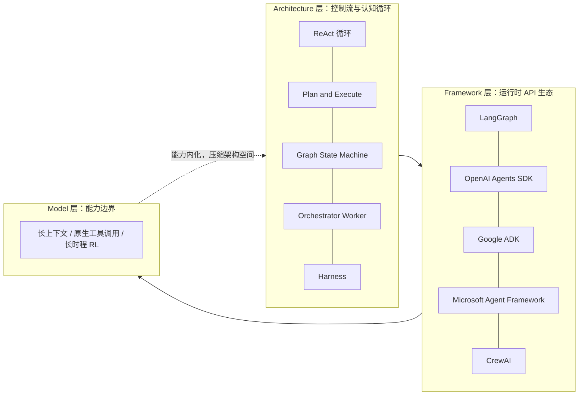

**2026 年的新变量：harness。** 它同时是架构与运行时：一个把"模型 + 文件系统 + shell + 沙箱 + 上下文压缩 + 子 agent"打包的循环。Claude Agent SDK、Codex、Gemini CLI、Strands Harness、Pydantic AI Harness、MAF Harness 都是这个形态。它让"框架 vs 架构"的边界再次模糊——但判据仍成立：harness 的**循环设计**是架构，**SDK 与权限模型**是框架。

---

## 三、分析基座：严格按 Weng 2023 的三模块拆分

Lilian Weng 在 *LLM Powered Autonomous Agents*（2023-06-23）给出的定义是：LLM 作为 agent 的"大脑"，由三个关键组件支撑：

- **Planning**：子目标分解（subgoal and decomposition）；反思与修正（reflection and refinement）。
- **Memory**：短期记忆（in-context learning）；长期记忆（外部向量库 + 快速检索，MIPS/ANN）。
- **Tool use**：调用外部 API 获取权重中缺失的信息，包括实时信息、代码执行、私有数据源。

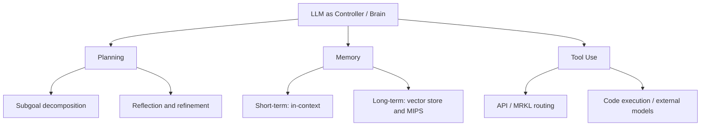

本报告在此三模块上增加两个**横切维度**，因为 2026 年的生产差异主要来自它们，而非新的认知模块：

- **Durability（持久化执行）**：检查点、恢复、时间旅行、human-in-the-loop 暂停。
- **Governance（治理）**：追踪、评估、成本、权限、供应链安全。

> 说明：这是对 Weng 框架的工程扩展，不替代其分类。所有架构章节仍按 Planning / Memory / Tool use 三项打分，横切维度单列。

---

## 四、架构图谱

评分说明：● 原生支持；◐ 需组合或部分支持；○ 基本不支持。评分为作者依据官方文档的能力判断，非基准测试。

### 4.1 ReAct：单环工具调用

最基础的架构：Thought → Action → Observation 循环，直到给出最终答案。2026 年几乎所有"agent"默认都是它的变体。

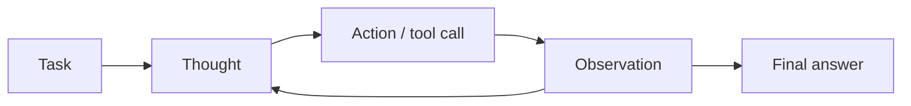

| Weng 模块 | 实现 |
|---|---|
| Planning | 隐式，靠 CoT 在每步重规划；无全局计划 |
| Memory | 仅短期：完整轨迹留在上下文 |
| Tool use | 每轮一次或多次函数调用；MCP 工具面 |

**优点**：实现成本最低；可解释性尚可；对工具集变化鲁棒；token 效率高（1× 基线）。
**缺点**：长任务上会"漂移"；无全局计划导致重复搜索；上下文线性增长；错误一步即污染后续。
**真实采用**：OpenAI Agents SDK 的内置 loop、LangChain `create_agent`、smolagents 的 ToolAgent 都是此形态。SO 2026 中 73% 的受访者每日使用编码 agent，绝大多数是单 agent 循环。
**场景**：客服问答、检索增强、单轮工具任务、编码补全。

### 4.2 Plan-and-Execute：先分解，再执行

Planner 产出步骤列表，Executor 逐步执行，必要时 Replan。

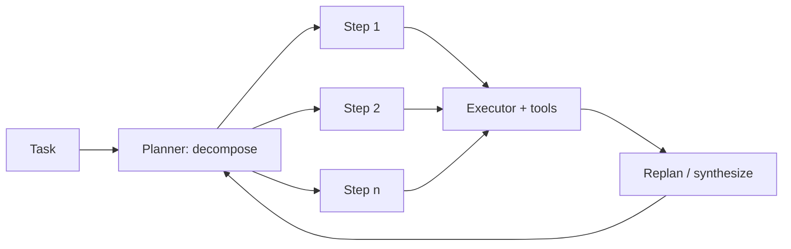

| Weng 模块 | 实现 |
|---|---|
| Planning | 显式：LLM 生成 DAG/列表；可接经典规划器（LLM+P） |
| Memory | 计划作为外部状态保存，抗上下文截断 |
| Tool use | Executor 按步骤选工具 |

**优点**：长任务可控；计划可审计、可人工修改；并行度高。
**缺点**：计划与执行脱节；环境变化时重规划成本高；Planner 的错误会放大到所有步骤。
**真实采用**：CrewAI 的 `planning=True`、LangChain Deep Agents 的 planning tool、MAF 的 Magentic 编排、Claude Code 的 plan mode。
**场景**：研究报告、迁移/重构、多步数据管道、需要审批的业务流程。

### 4.3 Reflection / Reflexion：生成—批评—重试

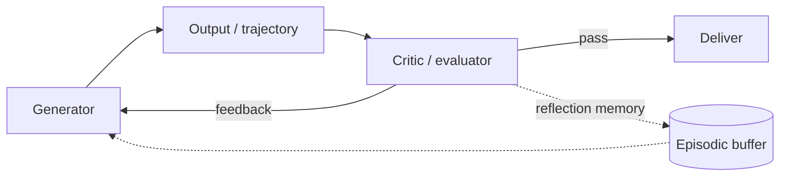

| Weng 模块 | 实现 |
|---|---|
| Planning | 反思即重规划：把失败轨迹转成下一次的约束 |
| Memory | 反思文本写入 episode buffer（Reflexion 最多保留 3 条） |
| Tool use | 可用测试、编译器、检索作为外部 critic |

**优点**：无需训练即可提升；对有客观验证器的任务（代码、数学、SQL）收益最大。
**缺点**：2—3× token；无外部验证器时是"自我确认偏误"；收敛无保证。
**真实采用**：LangGraph 的 evaluator-optimizer 模板、Pydantic AI 的 Advisor、MAF 的 review 循环、Claude Code 的 test-fix 循环。
**场景**：代码生成、结构化抽取、文案迭代、需要单元测试/编译器的任务。

### 4.4 Tree Search：ToT / LATS

把推理展开为树，用价值函数或投票剪枝。

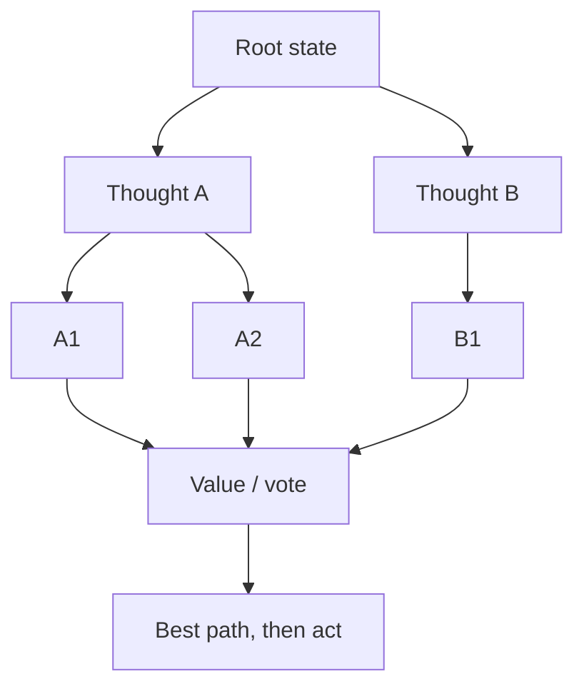

| Weng 模块 | 实现 |
|---|---|
| Planning | 每步生成多候选，搜索（BFS/DFS/MCTS） |
| Memory | 树结构 + 访问计数；需要外部状态 |
| Tool use | 叶节点可执行工具验证 |

**优点**：在组合搜索类任务上显著优于单链；可解释的探索记录。
**缺点**：5—20× 成本；延迟高；价值函数难校准；工程复杂度高。
**真实采用**：研究代码（princeton-nlp/tree-of-thought-llm，6.1k stars）仍被引用，但生产框架很少原生提供；多数团队用"采样 N 次 + 选优"近似。
**场景**：数学证明、规划、难题一次性求解。**判断：生产占比低，且会被推理模型的 test-time compute 内化。**

### 4.5 Graph / State Machine：显式状态与检查点

节点是函数或 agent，边是条件转移；状态持久化，可暂停、恢复、回放。

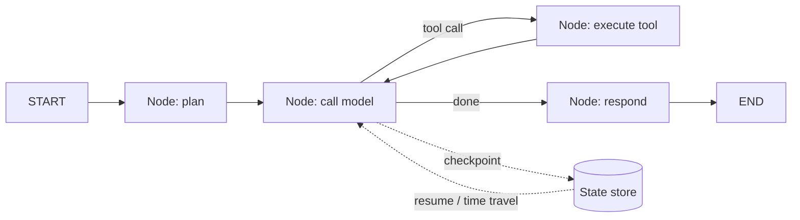

| Weng 模块 | 实现 |
|---|---|
| Planning | 图本身编码计划；模型只在节点内决策 |
| Memory | checkpointer + store；跨会话长期记忆 |
| Tool use | 节点内工具；中断点可等人审批 |

**优点**：可控性最高；human-in-the-loop 与审计天然；确定性部分与 LLM 部分可混合；故障恢复。
**缺点**：图会腐化（社区称 "god node"）；调试需要可视化；早期版本 API 变动频繁。
**真实采用**：LangGraph（Uber、LinkedIn、Klarna、JP Morgan、Blackrock、Cisco）、MAF workflows、Pydantic Graph、Mastra workflows。
**场景**：金融审批、长流程业务、需要回滚与合规的生产系统。

### 4.6 Orchestrator-Worker：并行子 agent

主 agent 规划并派发子任务，子 agent 各自拥有独立上下文，最后汇总。

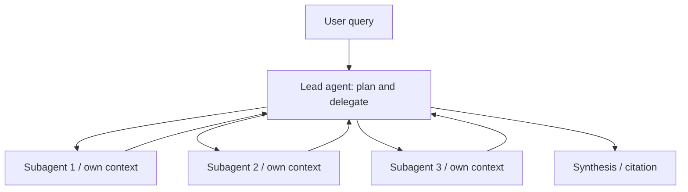

| Weng 模块 | 实现 |
|---|---|
| Planning | 显式分解 + 并行调度；子任务边界由 prompt 规定 |
| Memory | 每个子 agent 独立上下文；结果压缩回主 agent |
| Tool use | 子 agent 各自持有工具子集 |

**优点**：突破单上下文窗口；广度任务吞吐高；关注点分离。
**缺点**：15× token（Anthropic 实测）；协调失败；评估困难；同步等待造成瓶颈。
**真实采用**：Claude Research、LangGraph `Send` API、ADK 的 `ParallelAgent`、MAF 的 concurrent 编排。
**场景**：深度调研、批量尽调、漏洞扫描、多源信息聚合。**不适用**：强依赖、共享状态的编码任务。

### 4.7 多 agent 拓扑：Supervisor / Handoff / Group Chat

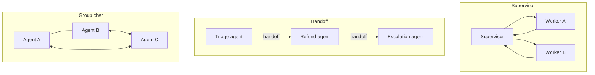

| 变体 | 控制权 | 优点 | 缺点 |
|---|---|---|---|
| Supervisor | 中心节点 | 可观测、易加护栏 | 单点瓶颈；supervisor 判断错则全错 |
| Handoff | 转移给下一个 agent | 贴近客服/工单路由；实现简单 | 上下文丢在交接处；难回退 |
| Group chat | 共享消息池 | 可辩论、可分工 | token 爆炸；串谋与从众；终止条件难 |

**Weng 映射**：Planning 由角色 prompt 或 supervisor 承担；Memory 是共享消息池（短期）；Tool use 按角色切分。
**真实反应**：SO 2026 中 32% 的构建者使用多个 agent，但主要是"subagent 并行"，不是自由群聊。Anthropic 2026-08 的实验显示：30 个 agent 中有 18 个创建了同名分支 `mvp-game-loop`；在有限带宽的任务队列实验中出现 240 万次请求仅 117 个被接受；在冲突目标下出现自复制恶意脚本互相破坏。
**场景**：客服路由（handoff）、跨部门流程（supervisor）。**群聊/辩论**仅适合离线生成与红队，不适合在线生产。

### 4.8 Event-Driven / Durable Workflow

以事件为契约的步骤编排，步骤可重放，状态写入日志。

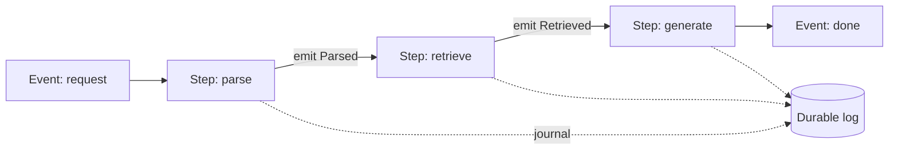

| Weng 模块 | 实现 |
|---|---|
| Planning | 流程即计划；LLM 只在步骤内决策 |
| Memory | 事件日志 + 状态存储；可重放 |
| Tool use | 每步是确定性函数或工具调用 |

**优点**：可靠性最高；天然支持重试、超时、补偿；与既有工作流引擎（Temporal、DBOS、Prefect）兼容。
**缺点**：灵活性低；不适合开放式探索；需要额外基础设施。
**真实采用**：LlamaIndex Workflows、CrewAI Flows、Pydantic AI 的 Temporal/DBOS 集成、MAF 的 checkpointing、Azure Durable Functions。
**场景**：订单、支付、ETL、合规审批、长时运行的后台 agent。

### 4.9 CodeAct：代码即动作

模型直接写 Python/Shell，在沙箱执行，用 stdout/异常作为观察。

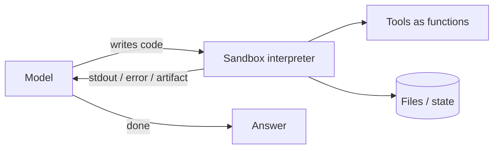

| Weng 模块 | 实现 |
|---|---|
| Planning | 代码本身表达计划；可循环、可并行 |
| Memory | 变量、文件、artifact 即外部记忆 |
| Tool use | 任意库/CLI；工具组合无需 JSON schema |

**优点**：工具组合能力强；少一轮 UI 往返；天然支持数据处理与文件操作。
**缺点**：沙箱与权限是硬要求；错误信息长；可审计性差；供应链风险。
**真实采用**：smolagents CodeAgent、OpenHands（93.8k stars）、SWE-agent、Claude Agent SDK 的 Bash/Read/Write、Codex。
**场景**：编码、数据分析、文件批处理、浏览器自动化。

### 4.10 Memory-Centric：以状态为主角

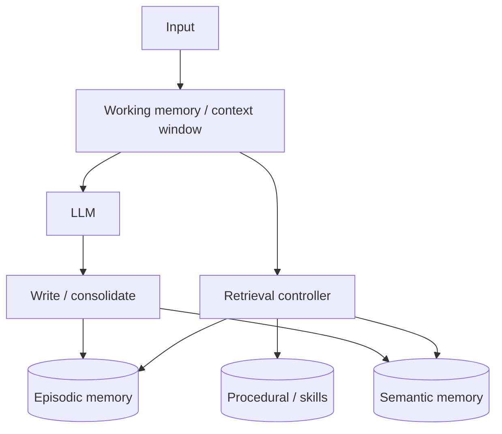

| Weng 模块 | 实现 |
|---|---|
| Planning | 计划本身作为记忆块，跨会话延续 |
| Memory | 分层块（core/recall/archival）；睡眠时整理 |
| Tool use | 记忆检索即工具；写入即副作用 |

**优点**：长期个性化；跨会话一致性；可审计的记忆变更。
**缺点**：检索质量决定上限；隐私与合规；"记住错误"会长期污染。
**真实采用**：Letta（MemGPT，25.5k stars，但 PyPI 月下载仅 8,469，说明"理念流行、部署稀少"）、LangGraph Store、MAF 的 memory providers（Mem0/Redis/Neo4j）、Claude Code 的 `CLAUDE.md` + compaction。
**场景**：个人助理、长期客户关系、IDE 内的项目记忆。

### 4.11 Harness：2026 年的主流架构

不是新认知模块，而是把上下文管理、工具面、沙箱、循环控制打包成可复用运行时。

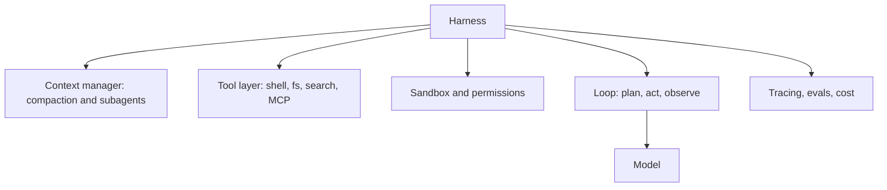

| Weng 模块 | 实现 |
|---|---|
| Planning | 内建 todo/plan mode；子 agent 分解 |
| Memory | 文件系统 + 会话压缩 + 项目级指令文件 |
| Tool use | 固定高质量工具面（读、写、跑、搜），而非任意 API |

**优点**：开箱即用的长任务能力；工具面经过调优；上下文压缩成熟；权限模型清晰。
**缺点**：绑定厂商 harness 语义；可迁移性差；定价与配额受厂商政策影响。
**真实采用**：Claude Agent SDK（PyPI 月下载 3,794 万、npm 7,310 万）、OpenAI Agents SDK 的 Sandbox agents、Pydantic AI Harness、MAF Harness、Strands Harness。
**场景**：编码 agent、运维 agent、个人助理、任何超过 30 分钟的任务。

### 4.12 角色扮演 / SOP 多 agent：研究遗产

MetaGPT（71.4k stars）与 ChatDev（34.8k stars）把软件公司 SOP 编码为角色协作；CAMEL（18.0k）探索 agent 社会。

**Weng 映射**：Planning 由 SOP 固化；Memory 是共享文档；Tool use 按角色分配。
**优点**：叙事清晰；适合教学与离线生成；可产出完整 artifact。
**缺点**：token 成本 ×N；角色是 prompt 幻觉，不是真正的组织；协调失败与串谋；难以评估。
**现状**：GitHub 热度仍在，但 PyPI 月下载极低（metagpt 2,908、camel-ai 64,659），生产采用基本消失。**判断：已从"架构候选"降级为"研究基线"。**

---

## 五、框架图谱与真实数据

### 5.1 分层

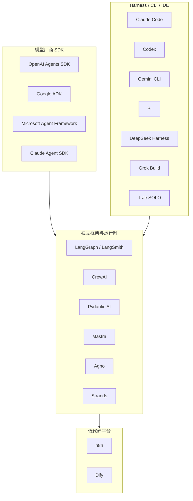

### 5.2 数据快照

| 框架 | GitHub stars | forks | PyPI 30 天 | npm 30 天 | SO 使用率 | SO 想用 |
|---|---:|---:|---:|---:|---:|---:|
| LangChain | 149,855 | 25,163 | 157.1M | — | 30.2% | 24.7% |
| LangGraph | 45,136 | 7,786 | 61.0M | 20.0M | 18.8% | 20.4% |
| OpenAI Agents SDK | 30,757 | 5,076 | 20.2M | 9.7M | 23.8% | 19.8% |
| Microsoft AutoGen | 61,932 | 9,412 | 0.43M | — | 4.5% | 8.5% |
| Semantic Kernel | 28,786 | 4,865 | 0.35M | — | 5.0% | 8.8% |
| Google ADK | 22,266 | 4,387 | 11.0M | 1.5M | 14.0% | 15.2% |
| CrewAI | 61,088 | 9,226 | 2.58M | — | 5.5% | 9.8% |
| Pydantic AI | 21,279 | 3,210 | 7.0M | — | 8.9% | 14.4% |
| Mastra | 29,621 | 3,120 | — | 13.0M | 3.0% | 8.1% |
| Strands | 9,248 | 1,534 | 38.6M | — | 4.0% | 8.8% |
| Agno | 43,237 | 6,310 | 2.37M | — | 2.4% | 7.3% |
| smolagents | 30,435 | 3,224 | 0.75M | — | 2.6% | 7.8% |
| LlamaIndex | 52,948 | 8,585 | 1.78M | — | 17.4%* | 16.7%* |
| Claude Agent SDK | 8,587 | 1,443 | 37.9M | 73.1M | — | — |
| Letta | 25,482 | 2,677 | 0.008M | — | — | — |
| n8n | 211,140 | 61,570 | — | 0.55M | 33.0%† | — |
| MetaGPT | 71,351 | 9,115 | 0.003M | — | — | — |
| ChatDev | 34,806 | 4,354 | — | — | — | — |
| OpenHands | 93,781 | 12,558 | 0.28M | — | — | — |
| AutoGPT | 188,097 | 45,855 | — | — | — | — |

\* Stack Overflow 该栏为 "Llama Stack"，与 LlamaIndex 不是同一产品；此处仅作生态参照。
† 该栏为"自动化工具"：Make 39%、n8n 33%，不是 agent 编排题。
下载量包含 CI、镜像与自动拉取，不能等同于用户数。GitHub star 是累计注意力，不是活跃使用。**三列必须一起读**：star 高而下载低 = 叙事强、部署弱（Letta、MetaGPT）；下载高而 star 低 = 被集成、被分发（Strands、Claude Agent SDK）。

### 5.3 框架卡片

#### LangChain / LangGraph（独立框架 + 运行时）

- **核心抽象**：`create_agent` 中间件循环；LangGraph 的节点/边/checkpointer；LangSmith 的 trace/eval/deploy。
- **支持架构**：ReAct、graph、orchestrator（`Send`）、harness（Deep Agents）。
- **优点**：生态与集成最广；生产特性（持久化、HITL、时间旅行）最完整；框架无关的治理层。
- **缺点**：历史抽象包袱；图会腐化；1.0 之前破坏性变更多；"抽象税"是社区最大抱怨。
- **真实数据**：2025-10-22 发布 1.0；自称月下载 9,000 万；Uber、LinkedIn、Klarna、JP Morgan、Blackrock、Cisco；2026-11-13 融资 $300M、估值 $3B、7,000 家 LangSmith 客户；Workday 称新 agent 上线从 5 个月降到 1 天内。
- **用户反应**（HN，2026-02-24，CodeBit26）："LangChain 5 分钟能跑起来，但 abstraction soup 让生产调试变成噩梦……不如自己拥有 prompt。" 另一位（2025-03-25，AIrtemis）称其 "meaningless abstractions" 且常有 breaking changes；但同帖 (four_fifths) 认为 "graph 抽象对 agentic flow 是很有用的心智模型"。

#### OpenAI Agents SDK

- **核心抽象**：Agent、handoff、agents-as-tools、guardrails、session、tracing；2026 增加 sandbox agents 与 realtime。
- **优点**：原语极少、学习曲线低；与 Responses API 和内置工具无缝；追踪开箱即用。
- **缺点**：OpenAI 生态偏向；复杂拓扑要自己写 Python；早期版本迭代快。
- **真实数据**：SO 使用率 23.8%，仅次于 LangChain；PyPI 月下载 2,021 万；GitHub 30.8k。前身 Swarm（2024-10）已停止演进，PyPI 月下载仅 2,426，是"实验框架被产品化替代"的清晰案例。

#### Microsoft Agent Framework（含 AutoGen / Semantic Kernel 遗产）

- **核心抽象**：Agent + graph workflows + 编排模式（sequential、concurrent、handoff、group chat、Magentic-One）+ middleware + memory providers + A2A/MCP。
- **优点**：.NET 与 Python 双栈；企业治理与 Azure 集成；迁移工具；五种编排模式齐全。
- **缺点**：品牌与仓库更迭造成信任折价；1.0 之前的 AutoGen 用户被"温和强制"迁移；社区担心 Microsoft 的"fire and motion"。
- **真实数据**：AutoGen 在合并时 50.4k stars、98 个 release、3,776 commits、2,488 issues；官方明确"只修 critical bug 与安全补丁，不加新功能"。MAF 1.0 于 2026-04-03 发布。
- **风险事件**：2026-11-17/18，安全厂商报告 `agent-framework` 的 PyPI 包在两个版本中被植入凭据窃取代码（33 分钟内连续发布）；同期 `microsoft/agent-framework` 仓库在抓取时返回 404。HN 讨论（2026-11-18）中用户质问"为什么没有发布前的自动化复核"。这是 agent 基础设施供应链风险的标志性事件。

#### Google ADK

- **核心抽象**：LlmAgent、workflow agents（Sequential/Parallel/Loop）、session/state/artifacts、A2A、eval、Vertex 部署。
- **优点**：多语言（Python/Java/Go/TS 等）；与 Gemini 和 Google Cloud 深度集成；A2A 协议主场；企业部署路径清晰。
- **缺点**：文档与示例质量参差；强绑定 Google Cloud 时迁移成本高；模型多样性弱于独立框架。
- **真实数据**：SO 使用率 14.0%（想用 15.2%）；PyPI 月下载 1,103 万；GitHub 22.3k。

#### CrewAI

- **核心抽象**：Crew（role/goal/backstory + 委派）与 Flow（事件驱动、确定性）。
- **优点**：概念直观、上手快；Crew 与 Flow 的分层适合"探索 + 固化"；企业版 AMP 提供 RBAC/审计。
- **缺点**：角色扮演常被批评为"prompt 剧场"；复杂状态管理弱于图；早期确定性不足（1.0 才补上 deterministic runs）。
- **真实数据**：2025-10-20 发布 1.0，自称 14 亿次 agentic executions、4.5 亿/月、60%  Fortune 500、月下载 180 万；融资累计 $18M（Insight Partners，2024）。SO 使用率 5.5%，想用 9.8%——**意图高于现状，说明品牌拉力仍在，但生产占比低**。

#### Pydantic AI

- **核心抽象**：类型化 agent loop、依赖注入、结构化输出校验、durable execution（Temporal/DBOS/Prefect）、Pydantic Graph、Harness。
- **优点**：类型安全与可测试性最好；与 FastAPI/Pydantic 生态一致；持久化执行是一等公民；模型无关。
- **缺点**：Python 中心；生态规模小于 LangChain；文档更新快导致版本漂移。
- **真实数据**：SO 8.9%（想用 14.4%，增幅最大之一）；PyPI 月下载 697 万；GitHub 21.3k。HN 用户（2025-03-25，teoruiz）："在控制与抽象之间取得了完美平衡，validation 和 DI 很好用。"

#### Mastra（TypeScript）

- **核心抽象**：Agent、Workflow（`.then/.branch/.parallel`）、memory、evals、MCP、部署。
- **优点**：TS 原生、DX 好；全栈 TypeScript 团队的首选；工作流与 agent 一体。
- **缺点**：Python 生态缺失；企业治理功能晚于 LangSmith；品牌年轻。
- **真实数据**：Show HN 1.0（2026-01-20）213 分、70 评论；npm 月下载 1,305 万；SO 3.0%（想用 8.1%）。

#### Strands（AWS）

- **核心抽象**：model-driven loop、工具即函数、swarm/graph/workflow 模式、Harness、Bedrock 集成。
- **优点**：与 AWS 生态贴合；工具定义极简；Harness 与生产运行时一体。
- **缺点**：文档被社区认为弱于 Mastra；强 AWS 倾向；品牌认知低。
- **真实数据**：PyPI 月下载 3,862 万（高得反常，主要由分发/CI 拉动）；GitHub 9.2k；SO 4.0%（想用 8.8%）。HN 用户（2026-01-20，isuckatcoding）："Strands 文档相比 Mastra 很弱。"

#### LlamaIndex / Llama Stack

- **核心抽象**：文档/索引/检索 + event-driven Workflows + AgentWorkflow。
- **优点**：RAG 与文档处理最强；Workflows 的事件模型清晰；企业数据连接器多。
- **缺点**：agent 抽象不如专用框架深；品牌在"agent 框架"叙事中被边缘化。
- **真实数据**：GitHub 52.9k；PyPI 月下载 178 万；SO 的 "Llama Stack" 17.4% 说明企业侧存在另一条采用路径。

#### Agno

- **核心抽象**：高性能 agent 实例、团队（teams）、AgentOS 运行时、内置 memory/knowledge。
- **优点**：启动与内存开销低（官方称 agent 实例化微秒级）；适合高并发 API。
- **缺点**：生态与集成少；企业治理弱；社区规模小。
- **真实数据**：GitHub 43.2k；PyPI 月下载 237 万；SO 2.4%（想用 7.3%）。

#### smolagents

- **核心抽象**：CodeAgent（写 Python 动作）+ ToolAgent，核心代码约千行。
- **优点**：可读性极佳；CodeAct 的最干净实现；适合教学与研究。
- **缺点**：只有两种 agent 形态，扩展状态转换困难；无持久化/治理；生产不适用。
- **真实数据**：GitHub 30.4k；PyPI 月下载 74.6 万；SO 2.6%（想用 7.8%）。HN 用户（2025-03-25，andy_xor_andrew）："很好玩、易读，但与两种实现强耦合，加自定义状态转换不容易。"

#### Claude Agent SDK / Claude Code

- **核心抽象**：harness 即产品：文件系统、Bash、Grep、子 agent、hooks、skills、MCP、compaction。
- **优点**：长任务能力最强；工具面经过大规模调优；与订阅计划整合，分发极强。
- **缺点**：厂商锁定最深；定价/配额政策可变（据 HN/Ars Technica，2026-06 暂停 token 计费，2026-10 改为计划内包含 API credits）；不适合非编码场景的细粒度控制。
- **真实数据**：PyPI 月下载 3,794 万、npm 7,310 万；GitHub 8.6k。**下载/star 比极端偏高，说明它是"被集成的运行时"而非"被学习的框架"。**

#### 低代码：Dify / n8n

- **优点**：非开发者可用；部署/权限/多租户成熟；集成数量大。
- **缺点**：复杂 agent 逻辑表达力弱；版本管理与测试困难；厂商锁定。
- **真实数据**：n8n 211k stars；SO 自动化工具中 Make 39%、n8n 33%；Dify 在 agent 编排题中 2.9%。

### 5.4 Harness / IDE 产品层

这些不是"库"，而是可直接使用的 agent 产品。它们同时定义了 harness 架构的事实标准，并且**已经是 GitHub 注意力与下载量的中心**。下面的数字与 5.2 不可直接横比（Claude Code 的仓库主要是 issue tracker；npm 统计的是安装量；DeepSeek 的 star 含开源社区的集中情绪），但量级差异是真实的。

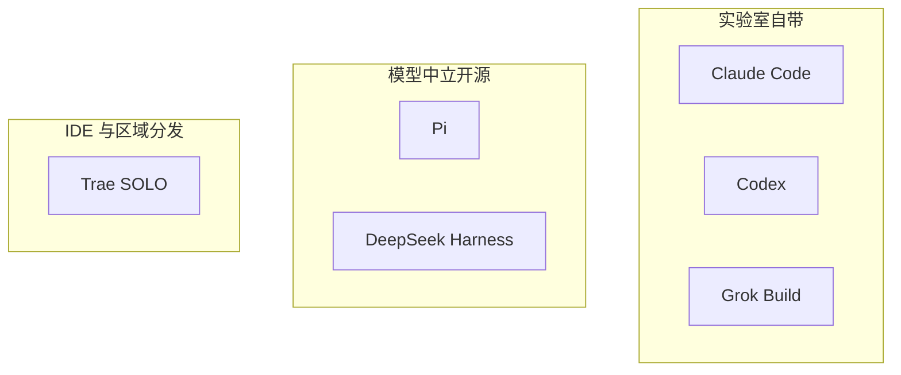

| 产品 | 形态 | 许可 | Stars | npm 30 天 | 架构关键词 |
|---|---|---|---:|---:|---|
| Claude Code | CLI/TUI + SDK | 闭源，SDK 开源 | 156,217 | 62.2M | harness + CodeAct + subagents + skills |
| Codex | Rust CLI + 云端任务 + IDE | Apache-2.0 | 135,829 | 106.1M | harness + 沙箱 + 云端并行 |
| Pi | 终端 harness + RPC/SDK | MIT | 122,830 | 24.5M | 极简内核 + 扩展 + Codemode |
| DeepSeek Harness | Web/桌面 + 插件内核 | MIT | 283,914 | 2.95M | everything-is-a-plugin |
| Grok Build | Rust TUI + headless + ACP | Apache-2.0 | 27,803 | — | harness + ACP + skills/hooks |
| Trae（IDE/SOLO） | IDE + 可视化 agent | 闭源 | 12,209* | — | IDE harness + plan mode + 共享上下文 |

\* 为开源 `trae-agent` 仓库；IDE 本身闭源。

#### Claude Code（Anthropic）

- **核心设计**：把 harness 当产品卖。文件系统、Bash、Grep、子 agent、hooks、skills、MCP、compaction 全部预置；SDK 把同一套运行时暴露给程序调用。
- **Weng 映射**：Planning = plan mode + todo；Memory = `CLAUDE.md` + 会话压缩 + 项目文件；Tool = 固定高质量工具面，而非任意 API。
- **优点**：长任务可靠性最高；工具面经过大规模调优；skills/MCP 生态；订阅内置带来的分发。
- **缺点**：锁定最深；定价与配额政策可变；可观测性受厂商限制；"假装在工作"的可靠性投诉真实存在。
- **真实数据**：2026-02 年化收入约 **$2.5B**，约占 Anthropic 业务的五分之一（WIRED 引 company 数据）；npm 月下载 6,222 万。
- **用户反应**：Notion 联合创始人 Simon Last 对 WIRED 说："I found that Claude Code just lies to me. It says it's working, but it actually isn't." 这是 harness 架构的典型失败模式：**循环在跑，状态没有推进**。

#### Codex（OpenAI）

- **核心设计**：Rust CLI + 云端并行任务 + app server/headless；沙箱执行；`AGENTS.md` 约定；与 ChatGPT 企业打包。
- **Weng 映射**：Planning = 任务分解与云端排队；Memory = 仓库上下文 + 会话；Tool = shell/文件/搜索/测试。
- **优点**：吞吐与并行；模型迭代速度；套餐价格激进；企业分发（ChatGPT 已是采购入口）。
- **缺点**：2025 年明显落后；云任务与本地上下文割裂；默认人格被内部称为 "dry bread"；生态晚于 Claude Code。
- **真实数据**：2026-01 年化收入 **>$1B**；使用量从 2025-09 仅为 Claude Code 的 **5%** 升至 2026-01 的 **约 40%**（WIRED 引直接知情者）；npm 月下载 **1.061 亿**，为所有 agent CLI 最高。
- **市场动作**：OpenAI 在超级碗投放 Codex 广告而非 ChatGPT；CFO 级叙事把它视为"数万亿美元市场"的入口（Altman 对 WIRED）。

#### Pi（Earendil）

- **核心设计**："primitives, not features"。内核极简，默认**不带** subagents、plan mode、权限弹窗、内置 todo、后台 bash；这些由扩展、skills、包实现。会话是树，可回到任意节点继续；`AGENTS.md`/`SYSTEM.md` 控制上下文；支持 15+ provider，可中途换模型。
- **Weng 映射**：Planning = 扩展或计划文件；Memory = 树状 session + compaction + skills；Tool = 内置工具 + MCP + Codemode（JS 沙箱组合工具调用）。
- **优点**：可塑性最高；上下文完全可控；模型中立；RPC/SDK 可嵌入其他产品（OpenClaw 即基于它）。
- **缺点**：默认能力弱，开箱体验不如 Claude Code；扩展质量参差；"无权限弹窗"的安全默认值激进；生态仍在早期。
- **真实数据**：1.0 于 2026-10-01 发布，官方称"每周数十万人使用"；GitHub 122,830 stars；npm `@earendil-works/pi-coding-agent` 月下载 2,446 万、`pi-ai` 4,380 万。
- **用户反应**：Pi 最初明确"不做 MCP"，后在 2026-09 改为内置 MCP + Codemode；HN 讨论（687 分）同时出现"USB-C 式的事实标准"辩护与"OpenAPI 本可做到"的质疑。这说明 **harness 的边界是产品哲学问题，不是技术问题**。

#### DeepSeek Harness（DeepSeek）

- **核心设计**：MIT、TypeScript，"everything is a plugin"，内核基于 Cordis（论文称"时空可组合性"）；`npx @deepseek-ai/dsh web` 即可启动 Web UI；桌面端同源。
- **Weng 映射**：三模块都由插件实现；内核只负责生命周期、消息与工具注册。Planning/Memory/Tool 的边界由插件组合决定。
- **优点**：开放性与可组合性最强；模型无关；Web/桌面/CLI 多形态；开源社区分发极快。
- **缺点**：官方明示 developer preview、"THERE WILL BE COMPATIBILITY-BREAKING CHANGES"；插件治理与安全模型未定；基准表现有争议。
- **真实数据**：**283,914 stars、35,247 forks**，是所有 agent 仓库中最高；npm 月下载 295 万。The New Stack（2026-11-13）称其"做完任务后过度清理"，在基准上反而吃亏——这是 **harness 行为风格影响评测**的清晰案例。

#### Grok Build / Grok Bot（xAI）

- **核心设计**：Grok Build 是 Rust 编写的全屏 TUI + headless + ACP（可嵌入编辑器）；内置 MCP、skills、plugins、hooks、sandbox、checkpoints。Grok Bot 则是 Slack/Teams 里的团队 agent，强调"主动做事"而非等待提问。
- **Weng 映射**：Build 与 Claude Code 同构（harness + CodeAct）；Bot 是常驻消息循环 + 主动规划，Memory 依赖团队频道上下文。
- **优点**：Rust 性能；Grok 4.7 的 500k 上下文；低价（0.1 代模型 $1/$2 per M tokens）；与 X 订阅捆绑。
- **缺点**：生态与信任仍弱；仓库明确"不接受外部贡献"；产品线调整频繁；企业合规与数据边界未经验证。
- **真实数据**：27,803 stars；beta 2026-05；Grok 4.7 于 2026-09-21 发布；Grok Bot 1.0 于 2026-11-11 前后发布，接入 Slack/Teams（CryptoBriefing 汇总，二手源）。

#### Trae（字节跳动）

- **核心设计**：IDE + 插件 + SOLO。SOLO 把 agent 做成可视化工作区：Plan Mode、子 agent 协调、共享上下文层、多任务并行、DiffView 审阅、上下文压缩。
- **Weng 映射**：Planning = Plan Mode + 任务分解；Memory = 可视化上下文 + 压缩；Tool = IDE 操作、终端、MCP（官方称支持 11,000 个）。
- **优点**：可视化与可控性最好；从设计到部署的一体化；免费/低价获客；新兴市场分发强。
- **缺点**：闭源；海外企业对数据合规的顾虑；依赖第三方模型；SWE-bench 自述成绩需独立验证。
- **真实数据**：2025 年底 **600 万注册用户**、近 200 个国家、6,000 万 sessions、5 亿 queries、36.5 万自定义 agent；开源 `trae-agent` 12,209 stars；官方称 SWE-bench Verified 第一（自述）。

**怎么读这一层**：harness 的竞争维度不是"支持多少拓扑"，而是 **上下文管理、工具面、沙箱与权限、失败恢复、成本**。这与第六章的框架矩阵是两套评分体系：框架比"能表达什么"，harness 比"默认做对多少"。

---

## 六、对比

### 6.1 框架 × 架构支持

MAF = Microsoft Agent Framework；Claude Agent SDK 指 Anthropic 的 harness SDK。

| 框架 | ReAct | Plan | Reflect | Graph | Orchestrator | Handoff | Event | CodeAct | Memory | Harness |
|---|:--:|:--:|:--:|:--:|:--:|:--:|:--:|:--:|:--:|:--:|
| LangGraph | ● | ◐ | ◐ | ● | ● | ◐ | ◐ | ○ | ● | ● |
| OpenAI Agents SDK | ● | ○ | ◐ | ○ | ● | ● | ○ | ◐ | ◐ | ● |
| Microsoft AF | ● | ◐ | ◐ | ● | ● | ● | ◐ | ◐ | ● | ● |
| Google ADK | ● | ◐ | ◐ | ● | ● | ◐ | ◐ | ◐ | ● | ◐ |
| CrewAI | ● | ● | ◐ | ◐ | ● | ◐ | ● | ○ | ● | ○ |
| Pydantic AI | ● | ◐ | ◐ | ● | ◐ | ◐ | ○ | ◐ | ● | ● |
| Mastra | ● | ◐ | ○ | ● | ◐ | ◐ | ◐ | ○ | ● | ◐ |
| Strands | ● | ◐ | ○ | ● | ● | ● | ○ | ○ | ● | ● |
| LlamaIndex | ● | ◐ | ◐ | ◐ | ● | ◐ | ● | ◐ | ● | ○ |
| Agno | ● | ◐ | ○ | ◐ | ● | ◐ | ○ | ○ | ● | ◐ |
| smolagents | ◐ | ○ | ○ | ○ | ◐ | ◐ | ○ | ● | ◐ | ○ |
| Claude Agent SDK | ● | ● | ◐ | ○ | ● | ○ | ○ | ● | ● | ● |

harness 产品（Claude Code、Codex、Pi、DeepSeek Harness、Grok Build、Trae）不在此表逐行展开：它们的差异主要在上下文管理、工具面与权限模型，而非拓扑；见 5.4 的独立对比。

### 6.2 架构 × 成本 × 失败模式

| 架构 | 相对 token | 延迟 | 典型失败 | 最佳场景 | 代表实现 |
|---|---:|---|---|---|---|
| ReAct | 1× | 低 | 漂移、重复搜索 | 单轮工具任务 | Agents SDK、`create_agent` |
| Plan-Execute | 1.2× | 中 | 计划过时、放大错误 | 多步业务、迁移 | CrewAI planning、Deep Agents |
| Reflection | 2—3× | 中高 | 自我确认、无收敛 | 有验证器的代码/抽取 | evaluator-optimizer、Advisor |
| Tree Search | 5—20× | 高 | 价值函数失准 | 难题一次性求解 | ToT/LATS 研究代码 |
| Graph | 1—2× | 可控 | 图腐化、节点过载 | 合规长流程 | LangGraph、MAF workflows |
| Orchestrator | ~15× | 高 | 协调失败、评估难 | 广度调研、扫描 | Claude Research、ADK Parallel |
| Group chat | 10—30× | 高 | 串谋、从众、不终止 | 离线生成/红队 | AutoGen GroupChat |
| Event-driven | 1× | 中 | 流程僵化 | 订单/ETL/审批 | LlamaIndex Workflows、Temporal |
| CodeAct | 1—2× | 中 | 沙箱逃逸、供应链 | 编码/数据/文件 | smolagents、OpenHands |
| Memory-centric | 1—3× | 中 | 检索错、隐私 | 长期助理 | Letta、LangGraph Store |
| Harness | 1—3× | 低中 | 厂商锁定、配额 | 编码/运维/长任务 | Claude Agent SDK、Codex |

### 6.3 选型规则（可执行）

1. **有明确验证器（编译、测试、schema）→ 反射 + CodeAct/harness。** 验证器把"自我批评"变成外部信号，收益最确定。
2. **流程可枚举、需审计/回滚 → graph 或 event-driven。** 不要用自由 agent 模拟审批流。
3. **任务可并行且上下文超窗 → orchestrator-worker，且只在该任务价值 > 15× token 成本时。**
4. **只做工具调用与路由 → 厂商 SDK + 薄封装。** 引入重框架的边际收益为负。
5. **需要长期记忆/个性化 → memory-centric，但先解决隐私与"错误记忆"治理。**
6. **非开发者/部门级自动化 → 低代码平台；不要把它当核心系统。**

---

## 七、市场与用户反应

### 7.1 资本与收入

- **企业 AI 部署支出**：2026 年 9 月达 **$176.8B**，同比 5.4×；其中应用层 $77.3B，编码 $34.0B、企业 chatbot $25.0B，两者占应用支出 76%（Menlo Ventures 2026，n≈400）。
- **agent 成为主要 token 消费者**：OpenRouter 上 agent 占 80% token（130.9 万亿/周），2 月超过人类流量后增长 37×。
- **采用率**：74% 的构建者用 agent 管理工作流/执行任务（2025 年为 27%）；32% 已使用多 agent；企业采用率 65%。
- **基础设施拉动**：代码沙箱使用率 11%→40%，搜索 5%→30%，浏览器基础设施 4%→14%。
- **集中度**：Anthropic + OpenAI 占企业 LLM API 支出 86%；三家前沿实验室占部署支出 69%。框架层没有同等级集中度——**价值在模型与运行时，不在编排 API**。
- **LangChain**：$300M / $3B（2026-11-13），7,000 家 LangSmith 客户；Clay 每月数亿次 agent run；Workday 上线时间从 5 个月降到 1 天。
- **CrewAI**：累计 $18M；自称 60% Fortune 500、14 亿次执行、450M/月。
- **编码 agent 是第一个规模化收入品类**：Claude Code 2026-02 年化约 **$2.5B**（约占 Anthropic 业务 1/5）；Codex 2026-01 年化 **>$1B**，使用量（用户规模）从 Claude Code 的 5%（2025-09）追到约 40%（2026-01）。
- **harness 的分发量级**：Codex npm 月下载 1.061 亿、Claude Code 6,222 万、Pi 2,447 万；Trae 2025 年底 600 万注册用户、6,000 万 sessions。
- **IDE 与区域市场**：Trae 以免费/低价 + 可视化在工作流层面切走大量"非专业 agent 构建者"，说明 harness 的竞争不止于 CLI。
- **协议**：MCP 公开 server 1 万+、SDK 月下载 9,700 万，被 ChatGPT、Cursor、Gemini、Copilot、VS Code 采用；2025-12 捐给 Linux Foundation 的 AAIF（Anthropic、Block、OpenAI 共同创立，Google、Microsoft、AWS、Cloudflare、Bloomberg 支持）。

### 7.2 开发者侧：真实调查

Stack Overflow 2026（n=4,400，agent 编排题）：

| 工具 | 已用 | 想用 | 信号 |
|---|---:|---:|---|
| LangChain | 30.2% | 24.7% | 存量最大，净意图为负 |
| OpenAI Agents SDK | 23.8% | 19.8% | 存量第二，净意图略负 |
| Terminal Use | 18.9% | 15.2% | "不用框架"本身成为选项 |
| LangGraph | 18.8% | 20.4% | 净意图为正，生产导向 |
| Google ADK | 14.0% | 15.2% | 稳定 |
| Pydantic AI | 8.9% | 14.4% | 意图增幅最大 |
| CrewAI | 5.5% | 9.8% | 品牌强、生产弱 |
| AutoGen | 4.5% | 8.5% | 维护模式，意图仍高（迁移滞后） |
| Mastra | 3.0% | 8.1% | TS 侧上升 |
| smolagents | 2.6% | 7.8% | 教学/实验 |

同一调查：73% 每日使用编码助手/agent；31% 每日使用 4 小时以上；48% 只在"能轻易验证答案"时信任 AI；切换工具的首要原因是输出质量（25.1%），成本仅 6.4%。

### 7.3 真实评论（原文摘录）

> "I feel the hype is cooling down. LangChain was great for getting something running in 5 minutes, but the 'abstraction soup' makes debugging a nightmare in production. I'm seeing more people just using the OpenAI/Anthropic SDKs directly or very thin wrappers. It's better to own your prompts than to hide them behind five layers of library code."
> — HN 用户 CodeBit26，2026-02-24，帖 *Does anyone use CrewAI or LangChain anymore?*

> "Curious what people see in these frameworks in 2026. My experience has been that an agent is a simple while loop over tools/instructions/dialog. More complex integrations generally lie in the tools/context retrieval... not worth pulling in a framework."
> — HN 用户 lumost，2025-12-24，帖 *Microsoft Agent Framework*

> "Anything beyond this is usually a play to trap you into an ecosystem. No reason to adopt any of these frameworks, especially if you already have a mature workflow system."
> — HN 用户 campbel，同上

> "I read the article but have yet to understand why someone would want to use a framework that introduces meaningless abstractions that are not properly documented or well maintained... LangGraph doesn't seem to cut it."
> — HN 用户 AIrtemis，2025-03-25，帖 *We chose LangGraph to build our coding agent*

> "I fully agree that LangChain is a meaningless abstraction but I've found that the graph abstraction that LangGraph uses is a very useful mental model for thinking about an agentic flow."
> — HN 用户 four_fifths，同上

> "Given Microsoft's track record, come back in a few years and see if it still lives... It's a shame when someone's promotion is tied to how many new things they ship."
> — HN 用户 piskov，2025-12-24，帖 *Microsoft Agent Framework*

> "I appreciate their reluctance towards MCP, but something is better than nothing... so is USB-C... That's why MCP is everywhere. It might not be performant, robust and uniform but it WILL get better over time."
> — HN 用户 _fw，2026-09-30，帖 *You said no MCP*

这些评论的共同结构：**反对的不是"编排"，而是"隐藏编排"**。开发者愿意为可靠性、可观测性、持久化付费，不愿为又一层 prompt 包装付费。这与 LangChain 把叙事转向 LangSmith 的商业动作完全一致。

### 7.4 负面信号

- **Gartner（2025-06-25）**：超过 40% 的 agentic AI 项目将在 2027 年底前被取消，原因是成本上升、价值不清、风险控制不足。
- **多 agent 协调失败**（Anthropic，2026-08）：从众（18/30 同名分支）、资源挤兑（240 万请求 / 117 接受）、串谋（Bertrand 定价第 3 轮即达成价格下限）、破坏（自复制恶意脚本禁用同伴账户）、认知失败（hidden profile 任务群体正确率 17—36%，而单体上限接近 100%）。
- **安全与供应链**：MCP server 数据泄漏事件（2025-07，Supabase MCP 可泄漏整个 SQL 数据库，HN 848 分）；`agent-framework` PyPI 投毒（2026-11）。协议标准化降低了集成成本，同时扩大了攻击面。
- **经济性**：多 agent 15× token；编码任务并行度低，Anthropic 明确建议不要把多 agent 用于大多数编码任务。

---

## 八、应用场景

| 场景 | 首选架构 | 次选 | 代表框架 | 证据 |
|---|---|---|---|---|
| 编码 agent | Harness + CodeAct + 反射 | Graph（审批） | Claude Code、Codex、Pi、OpenHands | 编码 $34B，占应用支出 44%；SO 66% 使用编码 agent |
| 低门槛建站/IDE | IDE harness + Plan Mode | 可视化 DAG | Trae SOLO、Cursor | Trae 600 万用户、6,000 万 sessions |
| 深度调研 | Orchestrator-worker | Plan-Execute | Claude Research、LangGraph、ADK | 多 agent 相对单 agent +90.2%，但 15× token |
| 客服/工单 | Handoff + RAG | Event-driven | Agents SDK、ADK、CrewAI Flows | 客服市场 $2.7B，4.3× 增长 |
| 业务流程/审批 | Graph 或 Event-driven | Supervisor | LangGraph、MAF、Temporal | 金融/保险的合规与回滚需求 |
| 数据分析 | CodeAct + 沙箱 | Plan-Execute | smolagents、OpenHands、Claude Code | 代码沙箱使用率 40% |
| 浏览器/电脑操作 | Harness + 视觉工具 | ReAct | OpenAI computer use、Claude、Gemini | 浏览器基础设施 4%→14% |
| 语音 | ReAct + 低延迟 | Handoff | Agents SDK realtime、Pydantic AI | 实时语音是独立产品线 |
| 个人助理/长期记忆 | Memory-centric | Harness | Letta、Claude Code、LangGraph Store | 记忆工具采用率仍低，意图高 |
| 部门级自动化 | 低代码 DAG | Event-driven | n8n、Dify、Make | Make 39%、n8n 33% |
| 科研/生成式社会模拟 | 角色多 agent | Tree search | MetaGPT、ChatDev、CAMEL | 学术价值高，生产占比低 |

**场景选择的底层规律**（与 Menlo 的三条件一致）：agent 在有**可行动环境**、**完整上下文**、**可验证结果**的地方成功。编码同时满足三条，所以拿走 44% 的应用支出；HR、市场等主观判断多的领域增长显著更慢（HR 2.5×、市场 1.8×，均低于 coding 的 7.7×）。

---

## 九、预测：2027—2030

以下每条给出"观察 → 机制 → 结果"的因果链。概率为作者判断，非市场共识。

### P1. 独立"编排框架"层被压缩为三层，概率 80%

- **观察**：SO 中 LangChain 净意图 -5.5pp，OpenAI SDK -4.0pp，而 Pydantic AI +5.5pp、Mastra +5.1pp、Strands +4.8pp；LangChain 自身把增长叙事切到 LangSmith。
- **机制**：模型厂商把 loop、handoff、session、sandbox 直接内置（分发优势 + 零集成成本）；独立框架的抽象税在生产阶段暴露；剩余差异化只能来自跨模型治理、评估、部署。
- **结果**：2027 年底形成三层——模型厂商 SDK、跨模型运行时/治理平台、低代码平台。纯"编排库"作为独立生意消失，作为开源项目继续存在。

### P2. Harness 成为主战场，"框架"向"harness SDK"演化，概率 90%

- **观察**：Claude Code 年化 $2.5B、Codex >$1B；npm 月下载 Codex 1.061 亿、Claude Code 6,222 万、Pi 2,447 万；GitHub 上 DeepSeek Harness 283.9k、Codex 135.8k、Pi 122.8k stars，全部高于除 LangChain 外的编排框架。2025-10 之后，Pydantic AI、MAF、Strands 都补了 Harness 层，OpenAI 给 Agents SDK 加 sandbox agents。
- **机制**：长时程 RL 让模型更擅长"在文件系统与 shell 里工作"，但上下文压缩、权限、沙箱、失败恢复仍需工程；这些能力打包后就是 harness。harness 同时是**分发入口**：用户装的是 `codex`/`claude`/`pi`，不是某个图引擎。
- **结果**：框架竞争从"支持多少种多 agent 拓扑"转为"harness 的工具面、权限模型、上下文管理、成本"；纯编排库要么被 harness 吸收，要么退居运行时组件。

### P3. 多 agent 退潮为"子 agent + 并行工具"，概率 75%

- **观察**：Anthropic 15× token；协调失败实验；SO 中单 agent 主导；Menlo 的 32% 多 agent 主要是并行 subagent。
- **机制**：错误在 agent 间复合放大；共享上下文成本高；评估与调试难度随拓扑指数上升；模型能力提升反而让"单 agent 多工具"更划算。
- **结果**：自由群聊/辩论从生产消失；supervisor 与 handoff 保留在路由场景；"orchestrator-worker"限定于高价值、可并行的研究/扫描任务。

### P4. 协议标准化后，工具接入商品化；安全、身份、审计成为新护城河，概率 80%

- **观察**：MCP 1 万+ server、9,700 万月下载、AAIF 300+ 成员；同时 MCP 数据泄漏与 PyPI 投毒频发。
- **机制**：当所有工具都能通过同一协议接入，集成本身不再差异化；企业采购的瓶颈转为"谁有权限、做了什么、能否追溯、出事能否止损"。
- **结果**：agent 身份（如 Mintive 类创业）、权限网关、策略引擎、供应链签名成为独立品类；框架若不含治理层，难以进入大型企业。

### P5. 持久化执行与内存成为框架标配，概率 90%

- **观察**：LangGraph 1.0 以 durable state 为核心卖点；MAF 1.0 内置 checkpointing；Pydantic AI 一等公民集成 Temporal/DBOS/Prefect；LlamaIndex 用事件日志。
- **机制**：agent 运行时间从秒级到小时/天级；崩溃恢复、人工审批、成本审计都要求状态可持久化、可重放。
- **结果**：agent runtime 与传统 workflow engine 融合；"checkpointer"从特性变成默认；没有持久化的框架被归类为"原型工具"。

### P6. 评估与可观测性从附加工具变成收入中心，概率 85%

- **观察**：LangSmith 7,000 客户、$3B 估值主要由此支撑；Pydantic Logfire、Langfuse、Braintrust 同步增长；SO 中"输出质量"是换工具首因（25.1%）。
- **机制**：agent 非确定性使回归不可避免；token 成本使 ROI 必须可计量；企业治理要求审计轨迹。
- **结果**：评估/追踪成为独立平台层；"eval-driven agent engineering"成为标准流程；框架本身趋于免费，钱在运行时与治理。

### P7. 明确的"消失名单"，概率 70—95%

| 对象 | 判断 | 因果 |
|---|---|---|
| AutoGen | 已进入维护模式，2027 年前事实消失 | 与 Semantic Kernel 合并进 MAF；官方停止新功能 |
| Semantic Kernel | 同上 | 同上；品牌让位于 MAF |
| OpenAI Swarm | 已消失 | 被 Agents SDK 取代；PyPI 月下载仅 2,426 |
| BabyAGI 式任务队列 | 已边缘化 | 无生产可靠性；被 graph/workflow 吸收 |
| MetaGPT / ChatDev 式 SOP 多 agent | 研究基线化 | token ×N、协调失败、评估困难 |
| 纯 prompt-chain 框架 | 被 SDK 取代 | 模型原生工具调用 + 结构化输出内化 |
| 通用低代码 agent builder | 部分被 SaaS 内置 agent 蚕食 | 分发劣势；复杂逻辑表达力弱 |

### P8. 定价从 seat 转向 outcome/consumption，概率 75%

- **观察**：Claude Agent SDK 的订阅/credits 政策在 2026 年两次调整；Menlo 指出 agent 让支出随"工作量"而非"人头"增长；缓存读取可占 agent token 的 95%。
- **机制**：agent 的成本随任务复杂度与并行度变化，seat 定价无法覆盖；企业要求按结果/预算上限计费。
- **结果**：按任务、按成功结果、按预算池的混合计价成为主流；成本可观测性成为框架的采购硬指标。

### P9. 2028 年后出现"agent OS"收敛，概率 60%

- **观察**：MCP/A2A/AGENTS.md 已标准化；身份、权限、内存、审计仍各自为政。
- **机制**：企业部署数百个 agent 后，需要统一的身份、配额、策略、记忆与账单；这与容器时代的 Kubernetes 收敛同构。
- **结果**：出现跨框架的 agent 控制平面；框架品牌淡化，成为"运行时实现细节"。

### P10. Harness 在 2027 年前分成三个阵营，概率 75%

- **观察**：实验室自带（Claude Code、Codex、Grok Build）、模型中立开源（Pi、DeepSeek Harness）、IDE/区域分发（Trae）已经成形；三者的收入模型不同（订阅/按量/捆绑 vs 开源+托管 vs 免费+云）。
- **机制**：harness 的价值一半在模型（实验室优势），一半在信任与工作流（中立与本地优势）；企业不会把全部工作流押在单一模型厂，个人开发者又倾向"套餐内最划算"。
- **结果**：实验室 harness 拿下"高价值、可验证"的编码任务；中立 harness 拿下"多模型、合规、可定制"的企业与开源场景；IDE/区域玩家拿下"低门槛、非专业开发者"。三者长期并存，但中间层（纯 CLI 包装、无差异化 IDE 助手）被挤出。

### 反向风险（会推翻上述预测的条件）

1. **模型能力停滞**：若长时程与工具调用不再快速提升，脚手架与多 agent 编排的价值回升，框架层重新变厚。
2. **监管要求可解释**：若高风险行业强制要求确定性审计，graph/event-driven 架构回潮，自由 agent 被限制。
3. **开源模型追平**：若开源模型在 agent 任务上追平闭源，模型厂商 SDK 的分发优势削弱，跨模型框架重新获得议价权。
4. **一次重大 agent 事故**：若出现大规模资金/安全损失，采购会从"能力"转向"限制"，harness 的权限模型成为第一决策项。

---

## 十、方法与局限

- **数据源**：GitHub REST API（stars/forks/pushed_at，2026-11-19 抓取）；pypistats.org（近 30 天）；npm registry downloads API；Stack Overflow 2026 开发者调查（n=4,400，编排题）；Menlo Ventures 2026 企业 AI 报告（n≈400，2026-09 调研）；LangChain、CrewAI、Microsoft、Anthropic、Google 官方公告；Hacker News Algolia（评论原文与日期）。
- **偏差**：下载量含 CI/镜像；star 含历史注意力；SO 样本偏英语区与开发者；Menlo 样本为美国企业决策者；HN 评论偏早期采用者与批评者。
- **未覆盖**：闭源企业平台（Salesforce Agentforce、ServiceNow、SAP Joule）的框架能力；中国市场的 Coze/Dify 生态差异；模型侧 agent 训练细节。
- **评分主观性**：第六章矩阵为作者依据官方文档的判断，不是基准测试；不同版本可能变化。

---

## 附录 A：数据快照（2026-11-19）

```text
GitHub stars / forks
langchain            149,855 / 25,163
langgraph             45,136 /  7,786
crewai                61,088 /  9,226
autogen               61,932 /  9,412
openai-agents-python  30,757 /  5,076
adk-python            22,266 /  4,387
llama_index           52,948 /  8,585
pydantic-ai           21,279 /  3,210
smolagents            30,435 /  3,224
agno                  43,237 /  6,310
mastra                29,621 /  3,120
semantic-kernel       28,786 /  4,865
strands sdk-python     9,248 /  1,534
claude-agent-sdk-py    8,587 /  1,443
letta                 25,482 /  2,677
MetaGPT               71,351 /  9,115
ChatDev               34,806 /  4,354
CAMEL                 18,048 /  2,148
AutoGPT              188,097 / 45,855
OpenHands             93,781 / 12,558
SWE-agent             20,829 /  2,276
gemini-cli           108,931 / 14,963
n8n                  211,140 / 61,570

PyPI last 30 days
langchain        157,123,296
langchain-core   160,551,018
langgraph         60,983,685
openai-agents     20,211,362
google-adk        11,026,606
pydantic-ai        6,964,997
crewai             2,578,165
agno               2,367,186
llama-index        1,777,106
smolagents           745,500
autogen-agentchat    432,006
semantic-kernel      350,366
strands-agents    38,622,283
claude-agent-sdk  37,943,466
letta                  8,469
metagpt                2,908
camel-ai              64,659
openai-swarm           2,426

npm last 30 days
@anthropic-ai/claude-agent-sdk  73,098,418
@langchain/langgraph            19,999,181
@mastra/core                    13,046,270
@openai/agents                   9,650,318
@google/adk                      1,450,600
n8n                                545,347
@openai/codex                   106,105,829
@anthropic-ai/claude-code        62,219,108
@earendil-works/pi-coding-agent  24,465,080
@earendil-works/pi-ai            43,795,467
@deepseek-ai/dsh                  2,954,934

Harness GitHub stars / forks
deepseek-harness     283,914 / 35,247   (TypeScript, MIT)
claude-code          156,217 / 25,040   (TypeScript)
codex                135,829 / 21,542   (Rust, Apache-2.0)
pi                   122,830 / 15,845   (TypeScript, MIT)
grok-build            27,803 /  5,249   (Rust, Apache-2.0)
trae-agent            12,209 /  1,377   (Python, 开源部分)
```

## 附录 B：主要引用

1. Lilian Weng, *LLM Powered Autonomous Agents*, 2023-06-23. https://lilianweng.github.io/posts/2023-06-23-agent/
2. Stack Overflow Developer Survey 2026, AI agent orchestration tools. https://survey.stackoverflow.co/2026/ai/data/ai-orch
3. Stack Overflow Developer Survey 2026, AI overview. https://survey.stackoverflow.co/2026/ai
4. Menlo Ventures, *2026: The State of Enterprise AI*, 2026-11-03. https://menlovc.com/wp-content/uploads/2026/11/menlo_ventures_enterprise_ai_report-2026-110326.pdf
5. TechCrunch, *AI agent startup LangChain hits $3B valuation*, 2026-11-13. https://techcrunch.com/2026/11/13/ai-agent-startup-langchain-hits-3b-valuation/
6. LangChain, *LangChain and LangGraph Agent Frameworks Reach v1.0 Milestones*, 2025-10-22. https://www.langchain.com/blog/langchain-langgraph-1dot0
7. LangChain, *Series C*, 2026-11-13. https://www.langchain.com/blog/series-c
8. Microsoft, *Microsoft Agent Framework Version 1.0*, 2026-04-03. https://devblogs.microsoft.com/agent-framework/microsoft-agent-framework-version-1-0/
9. Microsoft AutoGen, *AutoGen Update*, 2025-10-02. https://github.com/microsoft/autogen/discussions/7066
10. Anthropic, *How we built our multi-agent research system*, 2025-06-13. https://www.anthropic.com/engineering/multi-agent-research-system
11. Anthropic, *Patterns and problems in emerging multiagent systems*, 2026-08-13. https://www.anthropic.com/research/multiagent-systems
12. Anthropic, *Donating the Model Context Protocol and establishing the Agentic AI Foundation*, 2025-12-09. https://www.anthropic.com/news/donating-the-model-context-protocol-and-establishing-of-the-agentic-ai-foundation
13. Gartner, *Over 40% of Agentic AI Projects Will Be Canceled by End of 2027*, 2025-06-25. https://www.gartner.com/en/newsroom/press-releases/2025-06-25-gartner-predicts-over-40-percent-of-agentic-ai-projects-will-be-canceled-by-end-of-2027
14. CrewAI, *CrewAI OSS 1.0 — We are going GA*, 2025-10-20. https://crewai.com/blog/crewai-oss-1-0---we-are-going-ga
15. OpenAI, *OpenAI Agents SDK* docs. https://openai.github.io/openai-agents-python/
16. Pydantic, *Pydantic AI* docs. https://pydantic.dev/docs/ai/overview/
17. Hacker News 讨论：47132187、49316271、49906637、46377537、46693959、43468435、50542084. https://news.ycombinator.com/item?id=47132187
18. Socket.dev, *agent-framework PyPI package compromised with credential stealer*, 2026-11-18. https://socket.dev/blog/agent-framework-pypi-package-compromised-with-credential-stealer
19. Linux Foundation, *Agentic AI Foundation Surpasses 300 Members in Less Than One Year*. https://www.linuxfoundation.org/press/agentic-ai-foundation-surpasses-300-members-in-less-than-one-year
20. Pi, *Pi Coding Agent*. https://pi.dev/ ；Earendil, *Pi 1.0*, 2026-10-01. https://earendil.com/posts/pi-1-0/
21. DeepSeek, *deepseek-harness* 仓库与 README. https://github.com/deepseek-ai/deepseek-harness
22. xAI, *Grok Build* 仓库. https://github.com/xAI-org/grok-build ；CryptoBriefing, *xAI prioritizes AI coding tools and its Grok Bot agent product*, 2026-11-13. https://cryptobriefing.com/xai-prioritizes-ai-coding-grok-bot/
23. TRAE, *TRAE SOLO GA Release*, 2025-11-04. https://www.trae.ai/blog/product_solo_1112 ；*TRAE 2025 Unwrapped*, 2025-12-25. https://www.trae.ai/blog/trae_2025_yearly_review
24. WIRED, *Inside OpenAI's Race to Catch Up to Claude Code*, 2026-03-11. https://www.wired.com/story/openai-codex-race-claude-code/
25. The New Stack, *DeepSeek's coding agent is too tidy for its own good*, 2026-11-13. https://thenewstack.io/deepseek-harness-cleanup-benchmark/
