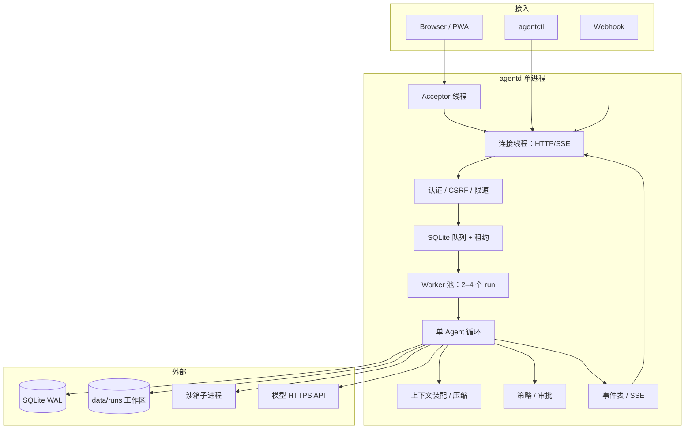
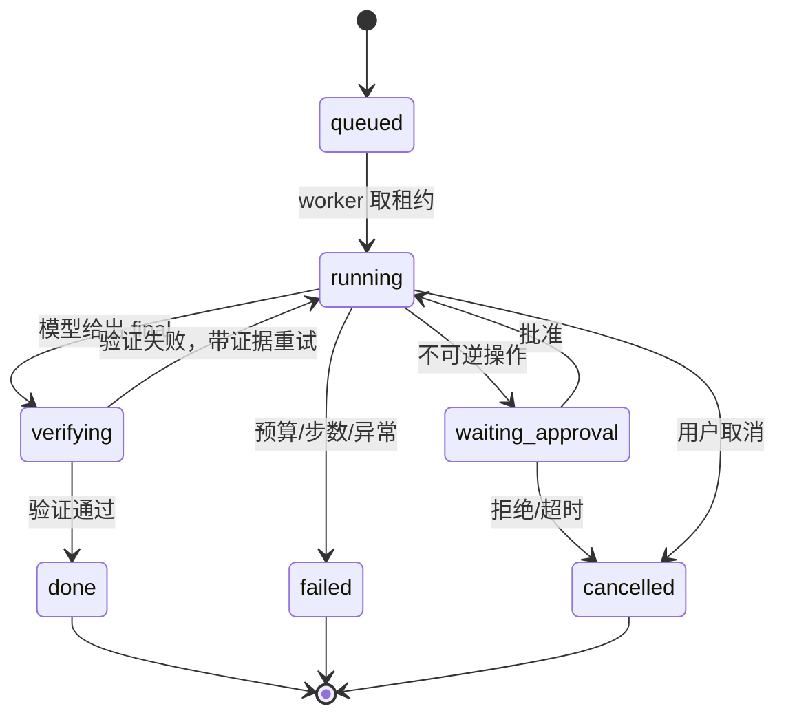
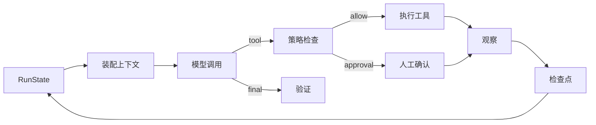

# 架构：家庭 Agent 系统（C++ / 零包管理器 / PQC-ready）

> 状态：设计稿。没有实现代码。  
> 范围：**本仓库只实现 kernel 层**；设备/系统/软件扩展在外部仓库。1 个用户先用，未来 ≤10 个家庭成员；单机部署；目标是可靠、可审计、可控成本，而不是多租户平台。详细边界见 [scope.md](scope.md)。

---

## 1. 目标与非目标

### 1.1 目标

1. **单二进制、单进程**：一个 `agentd` + 一个数据目录即可运行。
2. **零包管理器**：不引入 pip/npm/vcpkg/conan；只允许 OpenSSL 与 SQLite amalgamation。
3. **长任务可恢复**：分钟到小时级；崩溃/重启后从检查点继续。
4. **每个副作用可审计**：工具调用、审批、模型版本、成本都有记录。
5. **家庭隐私**：每个成员的数据默认隔离；共享需显式授权。
6. **PQC-ready**：传输用 hybrid TLS；长期数据用 hybrid KEM 信封加密；算法可迁移。

### 1.2 非目标

- 多租户 SaaS、配额计费、控制面/数据面拆分。
- 通用工作流引擎、可视化编排器。
- 多 agent 自由协作/群聊。
- MCP 市场、第三方插件市场。
- 模型训练/微调。

---

## 2. 约束与边界

| 类别 | 约束 |
|---|---|
| 语言 | C++20；POSIX；macOS 优先，Linux 次之 |
| 编译器 | Apple Clang / GCC 12+；CMake + Ninja |
| 加密 | OpenSSL **3.5.10+**（源码构建，静态链接，pin SHA-256） |
| 存储 | SQLite **3.54.1+** amalgamation；WAL；单写者 |
| 依赖 | 仅 libc/pthreads + OpenSSL + SQLite；无其他第三方代码 |
| 部署 | 单机；launchd/systemd；无容器、无 Kubernetes |
| 网络 | 默认只监听 LAN/localhost；远程用 VPN 覆盖网络，不直接暴露公网 |
| 模型 | 仅通过 HTTPS API 调用；无 SDK |
| 数据 | 每个用户独立目录；共享目录显式挂载 |

**零供应链的定义**：零包管理器、零自动依赖解析、零 CDN；不是零依赖。OpenSSL 与 SQLite 是刻意保留的两个可审计依赖。

---

## 3. 运行时架构



### 3.1 进程与线程模型

| 线程 | 数量 | 职责 | 阻塞点 |
|---|---:|---|---|
| Acceptor | 1 | `accept`，交给连接线程 | `accept` |
| 连接线程 | 每连接 1 | HTTP 解析、认证、SSE、入队 | socket |
| Worker | 2–4 | 执行 agent run | 模型 API、子进程 |
| 维护 | 1 | 租约回收、备份、清理 | 定时器 |

- 家庭规模下，**线程/连接 + 阻塞 I/O** 比 epoll 简单且足够；连接数 >500 再考虑事件驱动。
- 所有共享状态通过 SQLite 或显式 mutex；禁止跨线程裸指针。
- 每个 run 一个工作目录 `data/runs/<run_id>/`；路径做 `realpath` 前缀校验，防目录穿越。

### 3.2 SQLite 并发规则

- `PRAGMA journal_mode=WAL; PRAGMA busy_timeout=5000; PRAGMA foreign_keys=ON;`
- 每线程一个 `sqlite3*` 连接；**写操作串行化**（单写者 mutex 或单写线程）。
- 长事务禁止：每个 step 一个短事务。
- 读多写少；SSE 通过轮询事件表 + `rowid` 游标，不持有长事务。

---

## 4. Run 生命周期



### 4.1 不变量

1. **策略先于执行**：`policy.check` 在 `tools.execute` 之前。
2. **检查点后于执行**：每个 step 结束写 `steps` + `events`，再进入下一步。
3. **幂等键**：所有写工具必须带 `idem_key`；重试复用同一个键。
4. **预算硬停**：`spent_usd >= budget_usd` 或 `steps >= max_steps` 时暂停，不静默降级。
5. **单一写者**：同一 run 同一时刻只有一个 worker；租约过期才可被接管。
6. **版本固定**：run 记录 `model_version`、`prompt_version`、`tool_version`。

### 4.2 恢复语义

- Worker 崩溃：租约过期 → 另一个 worker 从最后一个 `ok` step 之后继续。
- 工具执行中崩溃：该 step 标记 `unknown`；恢复时先查询副作用（幂等键/对账），再决定重试或人工。
- 模型调用超时：重试 2 次（指数退避 + 抖动）；仍失败则暂停并请求人工，不无限重试。
- 取消：设置 `cancel_requested`；worker 在下一个安全点退出；子进程 `kill(-pgid)`。

---

## 5. 单 Agent 循环



### 5.1 上下文预算

| 项 | 默认 | 说明 |
|---|---:|---|
| 上下文使用率触发压缩 | 70% | 85% 强制 |
| 单步可见工具 | ≤30 | 超过则分组/延迟加载 |
| 单工具输出进上下文 | ≤8 KB | 大输出写对象存储，只放引用 |
| 每 run 最大步数 | 40 | 可配置 |
| 每 run 最大美元 | $2 | 可配置；家庭默认更低 |
| 模型调用超时 | 90 s | 流式可放宽到 10 min |

**装配顺序**（稳定前缀，缓存友好）：

1. 系统指令 + 安全策略
2. 工具使用规范 + 输出格式
3. 技能索引（名称 + 一行描述）
4. 任务目标 + 验收标准
5. 检索证据（带来源/时间）
6. 计划与进度
7. 最近 N 轮 + 最近观察
8. 当前候选工具 schema
9. 预算提示

### 5.2 验证优先

- `final` 不是“模型说完成”，而是**验证器通过**：测试、编译、schema、引用核对、人工确认。
- 验证失败时，把失败证据（stderr、diff、缺失字段）作为观察回注，而不是重新问一遍。
- 没有验证器的任务，至少要求结构化输出 + 人工抽检。

---

## 6. 工具层

### 6.1 首版工具（只做 6 个）

| 工具 | 副作用 | 说明 |
|---|---|---|
| `fs.list` | 无 | 限定工作区 |
| `fs.read` | 无 | 大小/类型限制 |
| `fs.write` | 写 | 仅工作区；审批可配 |
| `shell.run` | 写/不可逆 | 命令白名单；默认无网络；超时/killpg |
| `http.fetch` | 无（GET） | 出网 allowlist；响应大小限制 |
| `sqlite.query` | 无 | 只读连接；语句白名单/超时 |

后续再加：`browser.*`、`calendar.*`、`mail.send`（必须审批）、`payment.*`（默认禁用）。

### 6.2 ToolSpec

```text
name, description, input_schema
side_effect: none | read | write | irreversible
idempotent: bool
timeout_s, max_output_bytes
required_scopes: [..]
approval: never | write | irreversible
version
```

**规则**：

- `irreversible` 必须人工确认；超时视为拒绝。
- 工具参数做 schema 校验；拒绝未知字段。
- 工具输出先落对象存储，再给模型摘要 + 引用。
- 第三方 MCP 默认不接；如接，必须允许列表 + 版本/哈希固定 + 独立沙箱。

---

## 7. 沙箱

### 7.1 macOS

- `sandbox-exec`（系统自带，已标记 deprecated 但仍可用）：默认拒绝，只允许工作区读写与白名单可执行文件。
- 默认**禁止网络**；需要网络的工具走独立的 `http.fetch`，不在 shell 沙箱里放行。
- `fork` 后 `setsid`、`chdir`、`clearenv`、`setrlimit`、`execve`；父进程超时后 `kill(-pid, SIGKILL)`。

### 7.2 Linux

- `unshare(CLONE_NEWNET | CLONE_NEWNS)` 或 `unshare -n`；独立用户；只读根；`seccomp` 默认拒绝 + 允许 `read/write/exit/execve` 等最小集合。
- 不用 Docker（违反“零容器/零镜像”约束）。

### 7.3 资源限制

| 限制 | 值 |
|---|---|
| CPU 时间 | 30 s/命令 |
| 地址空间 | 512 MB |
| 文件描述符 | 128 |
| 进程数 | 32 |
| 输出 | stdout/stderr 各 8 KB 进上下文，原文落盘 |
| 网络 | 默认无；`http.fetch` 单独 allowlist |

**判断**：沙箱不是“防君子”，是防模型/网页注入导致的误操作。默认拒绝比“智能判断”可靠。

---

## 8. 安全架构

### 8.1 信任边界

| 区域 | 信任级别 | 规则 |
|---|---|---|
| 系统指令/策略 | 最高 | 只能由代码/管理员修改 |
| 用户输入 | 中 | 认证后；可触发工具，但受策略 |
| 工具返回 | 低 | 视为不可信内容；不能直接触发新工具 |
| 网页/文档 | 最低 | 只作为证据；永不作为指令 |
| 模型输出 | 低 | 只提议；策略与验证器决定执行 |

### 8.2 认证与会话

- 密码：`scrypt(N=2^14, r=8, p=1, dklen=32)`；每用户独立 salt。
- 会话：32 字节随机 token；DB 存 SHA-256；Cookie `HttpOnly; SameSite=Lax; Secure`。
- CSRF：每会话一个 token；所有写请求校验。
- 限速：登录按 IP + 用户名；失败指数退避。
- 角色：`admin / adult / teen / kid / guest`；`role × tool` 表控制。

### 8.3 加密

| 用途 | 方案 | 备注 |
|---|---|---|
| 传输 | TLS 1.3 + `X25519MLKEM768`，回退 `X25519` | 证书可继续用 ECDSA P-256 |
| 对称加密 | AES-256-GCM | 96-bit 随机 nonce；禁止复用 |
| 密钥派生 | HKDF-SHA256 | 不同用途不同 info |
| 密码 | scrypt | 不用自研 KDF |
| 数据密钥包裹 | X25519 + ML-KEM-768 → HKDF → KEK | 信封加密 |
| 签名（可选） | ML-DSA-65 | 发布物/审计批次 |
| 密钥存储 | macOS Keychain / Linux Secret Service / TPM | 不放 `.env` |

**信封格式（草案）**：

```text
magic "AGF1" | ver u8 | alg u8 | kem u8 | key_id u32
| nonce 12 | wrapped_len u16 | wrapped | ct_len u64 | ct | tag 16
```

AAD = 头部（含 ver/alg/kem/key_id/nonce）。解密失败必须 fail closed。

### 8.4 密钥生命周期

- 主密钥（KEK）不直接加密数据；只包裹 DEK。
- `key_id` 单调递增；`created_at` / `retired_at` / `compromised_at`。
- 轮换：新数据用新 key；旧数据保留一个恢复窗口；泄漏时重包所有 DEK。
- 备份加密密钥离线保存；恢复演练每月一次。

---

## 9. 供应链与 CVE 基线（2026-11-20）

### 9.1 允许的依赖

| 依赖 | 形式 | 版本 | 校验 |
|---|---|---|---|
| OpenSSL | 源码构建，静态链接 | **3.5.10+** | 官方 SHA-256 + 签名 |
| SQLite | amalgamation 单文件 | **3.54.1+** | 官方 SHA-256 |
| libc / pthreads | 系统 | OS 版本 | 系统更新 |

禁止：包管理器、自动更新、模型 SDK、MCP 第三方 server、CDN、容器镜像。

### 9.2 已核对的相关 CVE

> 结论：**PQC 的算法没有破，但实现层的 CVE 很密集。** 这支持“用 OpenSSL、别用 liboqs/wolfSSL、禁用无关特性”的决策。

| 组件 | CVE | 严重度 | 影响 | 修复/规避 | 对本项目 |
|---|---|---|---|---|---|
| OpenSSL 3.5.0–3.5.9 | CVE-2026-107493 | Low | `PEM_X509_INFO_read_bio_ex` 传外部 stack 时 UAF | 3.5.10 | 不用该 API；仍升级 |
| OpenSSL 3.5.0–3.5.9 | CVE-2026-35190 | Low | TLS 1.3 + Suite B 证书标志越界读 | 3.5.10 | 不启用 Suite B |
| OpenSSL 3.5.0–3.5.9 | CVE-2026-88823 | Low | AES-GCM-SIV 零长度 AAD 更新导致 AAD 未认证 | 3.5.10 | 用 AES-GCM，不用 SIV |
| OpenSSL 3.5.0–3.5.9 | CVE-2026-124709 | Low | QUIC 拒绝流的内存滞留 | 3.5.10 | 不启用 QUIC |
| OpenSSL ≤3.5.7 | CVE-2026-63072 | Moderate | CMS 解包堆越界写（可经 ML-KEM 解封装路径） | 3.5.8 | **禁用 CMS** |
| OpenSSL ≤3.5.7 | CVE-2026-18798 | Moderate | QUIC INITIAL 包双 free | 3.5.8 | 不启用 QUIC |
| OpenSSL ≤3.5.7 | CVE-2026-63076 / 14457 / 54874 / 63073 | Low–Moderate | CMP/RPK/DTLS 的 DoS | 3.5.8 | 禁用 CMP/DTLS/RPK |
| OpenSSL CLI | CVE-2025-15469 | — | `openssl dgst` 一次性签名静默截断 >16 MB | 查公告 | 大文件用 EVP 流式，不用 CLI |
| liboqs ≤0.10.0 | CVE-2024-36405 | Moderate (5.9) | Kyber 控制流时序泄漏；PoC 约 10 分钟恢复 ML-KEM-512 私钥 | 0.10.1 | **不用 liboqs** |
| liboqs <0.13.0 | CVE-2025-48946 | — | 密钥相关分支/时序问题 | 0.13.0 | 不用 |
| liboqs <0.16.0 | CVE-2025-52473 / 2026-44518 / 46344 / 44519 / 47738 / 104254 | — | 秘密相关分支、越界读、`ct_select`、derand 问题 | 0.16.0 | 不用 |
| wolfSSL ML-KEM | CVE-2026-10097 | — | AVX2 实现只比较 1536/1568 字节密文 | 升级 | 不用 wolfSSL |
| wolfSSL ML-KEM | CVE-2026-6330 | — | ARM64 NEON 只比较一半输入，破坏 FO 隐式拒绝 | 升级 | 不用 wolfSSL |
| Bouncy Castle | CVE-2024-14041 | — | ML-KEM 多项式系数除以 q | 1.78 | 不用 Java |
| SQLite 3.54.0 | CVE-2026-119373 / 119374 / 119379 | — | FTS5 / session 堆溢出 | 3.54.1 | 禁用 FTS5/session；升级 |
| SQLite 3.54.0 CLI | CVE-2026-119586 | — | `.recover` 命令注入 | 3.54.1 | 不对不可信 DB 跑 CLI |
| SQLite | CVE-2025-6965 | — | 整数溢出（按发行版公告） | 最新补丁 | 升级 + 最小化 SQL |

### 9.3 构建加固

- OpenSSL：`no-shared no-module no-quic no-cms no-cmp no-dtls no-ssl3 no-comp no-weak-ssl-ciphers`
- SQLite：`SQLITE_OMIT_LOAD_EXTENSION`、`SQLITE_DQS=0`、`SQLITE_OMIT_DEPRECATED`、不启用 FTS5/session
- C++：`-O2 -fstack-protector-strong -D_FORTIFY_SOURCE=3 -fPIE -pie`；macOS 用 `-Wl,-dead_strip`，Linux 用 `-Wl,-z,relro,-z,now`
- 调试/CI：ASan + UBSan；HTTP/JSON 解析器做 fuzz；SQL 只允许参数化。
- 可复现：`SOURCE_DATE_EPOCH`、`-ffile-prefix-map`、静态链接、构建清单（文件 + SHA-256）。

### 9.4 升级节奏

- 每月检查：OpenSSL 3.5 公告页、SQLite release log、NVD 关键词（OpenSSL / ML-KEM / ML-DSA / SQLite）。
- 紧急：Critical/High 24 小时内评估；Moderate 7 天内。
- 每次升级：重建 → 跑 20 条黄金集 → 检查 TLS 协商组 → 再发布。

---

## 10. 数据模型（摘要）

| 表 | 关键列 | 说明 |
|---|---|---|
| `users` | id, household_id, role, pass_hash, pass_salt | 家庭账户 |
| `sessions` | token_hash, user_id, csrf, expires_at | 会话 |
| `runs` | id, user_id, goal, status, budget_usd, spent_usd, model, version | 一次任务 |
| `steps` | run_id, idx, kind, tool, args_json, status, observation, artifact, idem_key | 步骤 |
| `events` | id, run_id, type, payload_json | SSE/审计 |
| `approvals` | id, run_id, action_json, status, decided_by | 审批 |
| `memories` | id, user_id, scope(private/shared), text, source, expires_at | 记忆 |
| `keys` | key_id, alg, created_at, retired_at, wrapped_private | 加密密钥 |
| `audit` | id, actor, action, target, result, ts | 管理审计 |

**从第一天就带** `household_id`、`user_id`、`memory.scope`。现在只有一个人，后补代价高。

---

## 11. 失败模式

| 故障 | 行为 |
|---|---|
| 模型 API 超时/429 | 退避重试 2 次；失败暂停，提示人工 |
| 模型 API 密钥失效 | 启动自检 + 运行时明确报错；不静默切到未知模型 |
| Worker 崩溃 | 租约过期接管；从最后 `ok` step 恢复 |
| 工具执行中崩溃 | 标记 `unknown`；用幂等键对账后重试 |
| 沙箱超时 | `kill(-pgid)`；记录；不回注无限输出 |
| 磁盘满 | 停止写；只读降级；告警 |
| SQLite busy | 短重试 + 背压；不无限等待 |
| TLS 协商降级 | 记录并告警；可配置“禁止非 hybrid” |
| 密钥泄漏 | 标记 compromised；重包 DEK；审计 |
| 备份损坏 | 每月恢复演练；校验 `PRAGMA integrity_check` |

---

## 12. 架构决策记录（ADR）

### ADR-1：C++ 而不是 Go/Python

- **决定**：C++20。
- **理由**：单二进制、手动控制进程/内存/沙箱；符合“零包管理器”。
- **代价**：HTTP/JSON/TLS 胶水代码多；内存安全风险；开发周期约为 Python 的 3×。
- **备选**：Go（标准库覆盖 HTTP/TLS/JSON，开发更快）；Rust（内存安全，但依赖 crates）。
- **复审触发**：如果 6 个月内 HTTP/JSON 层成为主要 bug 来源，改用 Go 重写接入层。

### ADR-2：OpenSSL 而不是 liboqs

- **决定**：OpenSSL 3.5.10+ 提供 TLS 与 PQC。
- **理由**：TLS 集成成熟；ML-KEM/ML-DSA 在主库；audit 面集中。
- **证据**：liboqs 在 2024–2026 有多次时序/越界/`ct_select` CVE；oqs-provider 另有 CVE。
- **代价**：OpenSSL 本身体积大；需裁剪特性。

### ADR-3：SQLite 而不是 Postgres

- **决定**：SQLite WAL + 单写者。
- **理由**：单机、家庭规模；零运维；备份简单。
- **复审触发**：>3 个并发写事务持续 1 分钟，或 DB > 5 GB。

### ADR-4：线程/连接而不是 epoll

- **决定**：每连接一个线程 + 阻塞 I/O。
- **理由**：家庭规模连接数低；代码简单；调试容易。
- **复审触发**：并发连接 >500 或内存 >500 MB。

### ADR-5：不接 MCP（首版）

- **决定**：首版只做 6 个原生工具。
- **理由**：MCP server 是第三方代码，与“零供应链”冲突；工具少反而提升选择质量。
- **复审触发**：出现必须接的外部系统，且能独立沙箱 + 允许列表。

### ADR-6：PQC 只用于两处

- **决定**：TLS hybrid + 长期数据信封加密；不做全站 PQC 签名。
- **理由**：对称加密已抗量子；证书生态未成熟；复杂度应可控。
- **复审触发**：私有 CA 需要抗量子签名，或外部合规要求。

---

## 13. 性能目标（不含模型延迟）

| 指标 | 目标 |
|---|---|
| API 额外延迟 p95 | <50 ms |
| TLS 握手 p95（LAN） | <100 ms |
| 空闲内存 | <200 MB |
| 并发 run | 4（默认），可配到 8 |
| 1 GB 备份信封加密 | <10 s（AES-NI） |
| 崩溃恢复 | <5 s 找到检查点 |

---

## 14. 未决问题

1. macOS `sandbox-exec` 已 deprecated；未来是否改为“独立用户 + 网络扩展”？
2. TLS 证书是否走私有 CA + ML-DSA（全 PQC 认证），还是继续 ECDSA + hybrid KEX？
3. 家庭共享记忆的授权 UI 如何做（按条目、按主题、按人）？
4. 模型路由：是否允许自动降级到便宜模型？降级会改变行为，需要 eval 门禁。
5. 备份密钥的离线保存与继承方案（家庭应急访问）。
6. 是否支持语音入口（老人/儿童）以及其隐私边界。

---

## 15. 具身扩展（机器人）

机器人不是另一套 agent，而是工具层的一个 provider。完整设计见 [robotics.md](robotics.md)。

- **三层控制**：云端认知（0.5–5 s）→ 边缘技能（20–50 Hz）→ MCU 实时（1–10 kHz）。
- **技能而非力矩**：模型只调用 `nav.move_to`、`arm.pick` 等技能；永远不直接写 PWM/CAN 力矩。
- **安全独立**：E-stop、watchdog、限速/限力、地理围栏由 MCU/硬件执行，云端无权覆盖。
- **失效安全**：断网/超时/状态过期 → 停止/保持/返航，不执行缓存计划。
- **契约复用**：`ToolSpec` 扩展为 `SkillSpec`，`side_effect` 增加 `physical`；每个技能调用仍是一个可审计 step。
- **执行器层**：`ActuatorSpec` / `JointSpec` / `MechanismSpec` / `IoSpec` 把技能落到电机、铰链、夹爪、继电器；详见 [hardware.md](hardware.md)。
- **物理世界接口**：传感器 → 符号化状态/事件/affordance → LLM；意图 → 指代消解/接地校验 → 技能；详见 [world-interface.md](world-interface.md)。
- **最小内核与扩展**：内核只提供 Run/Event/Tool/Skill/Sensor/Actuator/World/Store 等稳定端口；扩展按 `software` / `os` / `hardware` 三类分域，各自独立进程、独立项目；详见 [kernel-ports.md](kernel-ports.md)。

## 16. 参考

- OpenSSL 3.5 vulnerabilities: https://openssl-library.org/news/vulnerabilities-3.5/
- OpenSSL security advisories: https://openssl-library.org/news/
- SQLite release log: https://sqlite.org/releaselog/current.html
- NVD: https://nvd.nist.gov/
- liboqs advisory GHSA-f2v9-5498-2vpp: https://github.com/open-quantum-safe/liboqs/security/advisories/GHSA-f2v9-5498-2vpp
- NIST FIPS 203/204/205 (2024-08)
