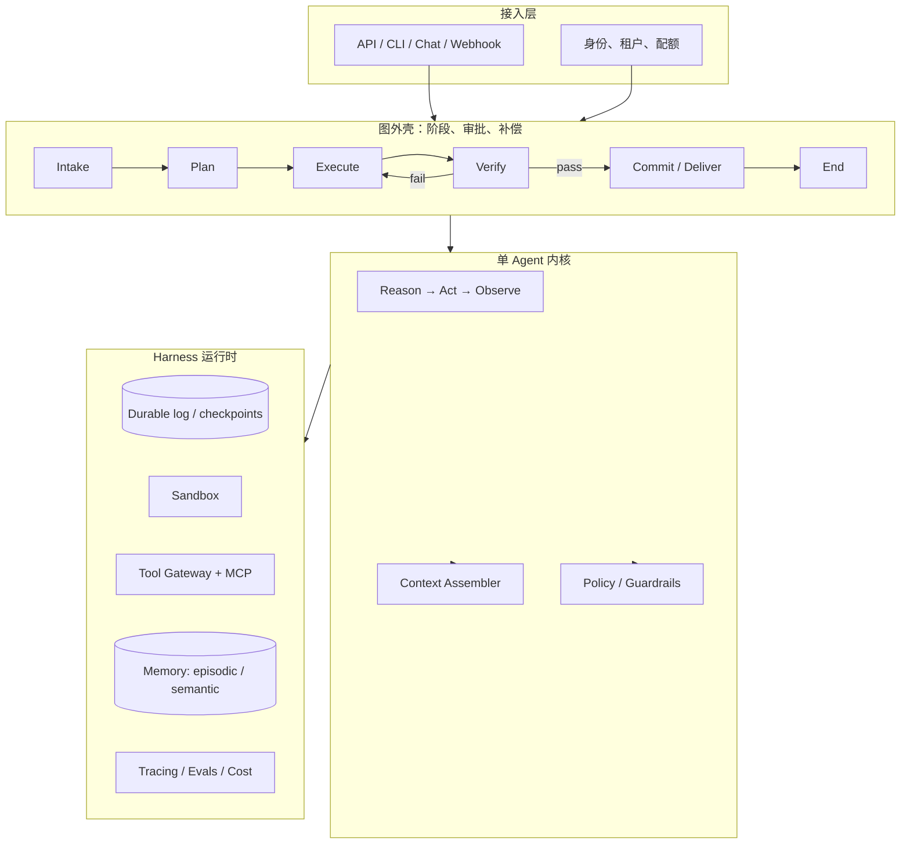
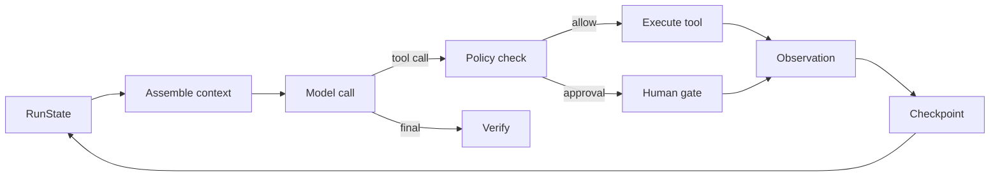
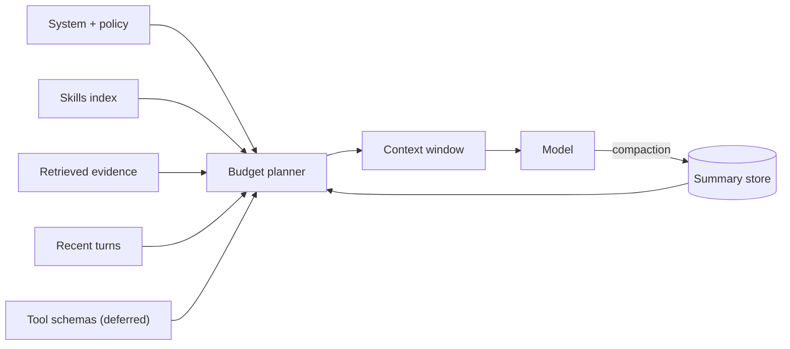
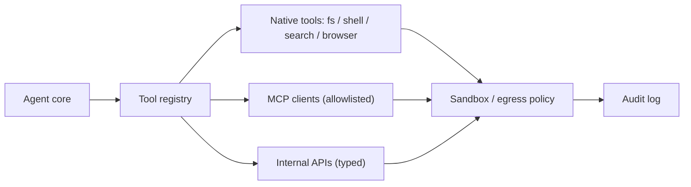
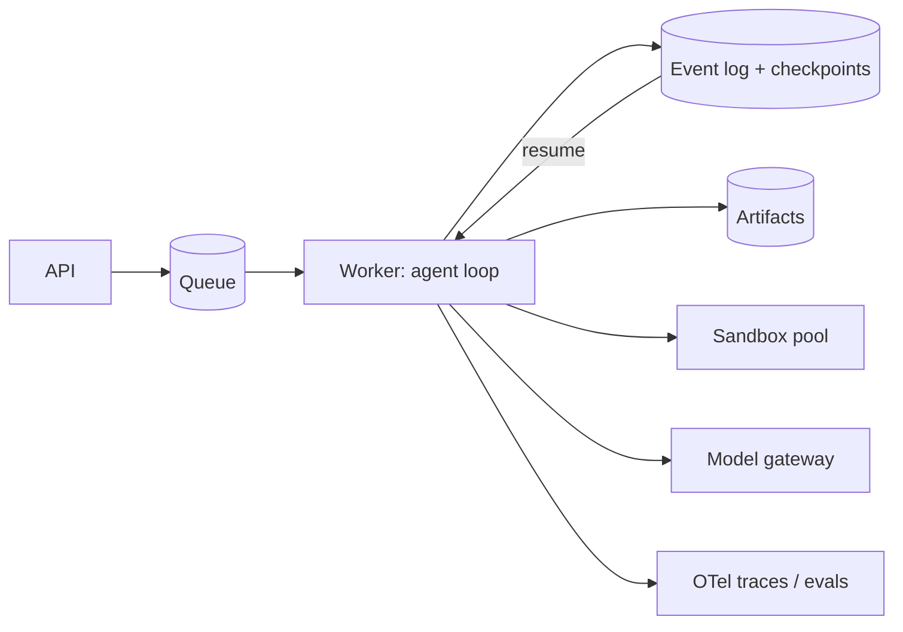
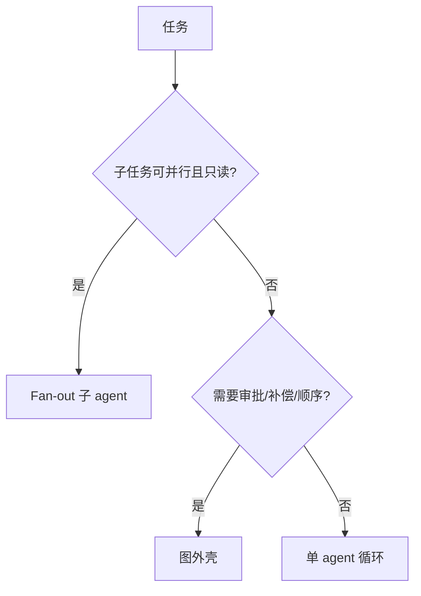

# 通用 Agentic System 设计方案（2026-11）

> 结论先行：**做"单 Agent 内核 + 显式图外壳 + 持久化 Harness 运行时"**，不要做"多 Agent 社会"，也不要把控制流交给框架的隐式抽象。
>
> 一句话公式：**通用性来自工具与上下文，不来自 agent 数量；可靠性来自状态机与持久化，不来自更聪明的 prompt。**
>
> 本文依据 `2026-agent-framework-architecture-report.md` 的数据与结论；标注"判断"处为设计取舍，不是披露数据。

---

## 一、先看证据：哪些数据直接决定设计

| 证据 | 数字 | 对设计的强制约束 |
|---|---|---|
| Stack Overflow 2026：agent 编排使用率 | LangChain 30.2%、OpenAI Agents SDK 23.8%、LangGraph 18.8%；"Terminal Use" 18.9% | 默认用厂商 SDK + 薄封装；不要为了"框架"引入重抽象 |
| Menlo 2026：生产中的 agent 形态 | 74% 构建者用 agent，但仅 32% 用多 agent | 单 agent 是常态；多 agent 是例外，不是默认 |
| Anthropic：token 成本 | 普通 agent ≈ 4× chat；多 agent ≈ 15× | 多 agent 必须有明确的并行收益与预算上限 |
| Anthropic：多 agent 研究系统 | 相对单 agent +90.2%，但仅适合可并行、可验证的广度任务 | 子 agent 只用于"只读并行"，不用于共享写域 |
| Anthropic 2026-08：协调失败 | 18/30 同名分支；240 万请求仅 117 接受；定价串谋；恶意脚本互杀 | 禁止自由群聊/辩论式拓扑；必须显式契约与单一写者 |
| Gartner：项目取消率 | >40% 的 agentic 项目将在 2027 年底前取消 | 先做持久化、评估、审批与成本控制，再做自治 |
| LangChain：$300M / $3B；SO 净意图 -5.5pp | 钱在运行时与治理，不在编排 API | 编排层自持薄代码；把预算投向 trace/eval/policy |
| MCP：1 万+ server、9,700 万月下载；多起泄漏/投毒 | 协议已商品化，安全是差异 | MCP 只作工具接入层；默认拒绝、允许列表、沙箱 |
| Harness 规模：Codex npm 1.06 亿/月、DeepSeek Harness 283.9k stars | 用户装的是 harness，不是图引擎 | 先补齐文件系统、shell、沙箱、上下文压缩，再谈拓扑 |
| Menlo：编码占应用支出 44%；沙箱 40%、搜索 30% | 编码是最强场景；执行环境是刚需 | 第一版就做代码执行 + 检索 + 工件系统 |
| SO 2026：48% 只在"能轻易验证"时信任 AI | 验证器决定采用 | 每个任务都要可验证的完成标准，而不是让模型自评 |

**推论**：一个"通用"系统，应该把 80% 工程量投在 **上下文、工具、执行环境、状态、验证** 上；拓扑只占 20%，且默认是"一个循环"。

---

## 二、设计原则（按优先级）

1. **单核优先**：一个 agent 循环处理开放式任务；只有"可并行、只读、可合并"的子任务才分叉。
2. **图只用于承诺**：审批、补偿、重试、顺序依赖、审计，用显式状态机；开放式探索用循环。
3. **上下文是稀缺资源**：稳定前缀 + 按需加载 + 主动压缩；不做"全量塞入"。
4. **一切副作用可重放**：每个工具调用有幂等键；每步有检查点；崩溃可恢复；副作用有 outbox。
5. **验证器优先于批评者**：编译器、测试、schema、检索引用、人工审批，优先于"再叫一个模型来批评"。
6. **协议商品化，安全差异化**：MCP 只是 USB-C；真正的护城河是权限、身份、审计、供应链。
7. **框架可替换，状态归自己**：agent 的 run state、trace、eval 数据必须存在你自己的库里。

---

## 三、总体架构："单核图壳"



三层职责必须硬隔离：

| 层 | 负责 | 不负责 | 失败时的表现 |
|---|---|---|---|
| 图外壳 | 阶段、顺序、审批、补偿、超时 | 具体推理与工具选择 | 流程卡住但状态可恢复 |
| 单 Agent 内核 | 推理、选工具、写计划、处理观察 | 跨阶段的持久化与权限 | 单步失败，可重试/升级 |
| Harness 运行时 | 上下文、沙箱、工具、记忆、遥测 | 业务语义 | 资源/权限/恢复问题 |

**为什么不是纯 ReAct**：纯循环在长任务上会漂移，且无法表达"审批后才能写库"。**为什么不是纯图**：图无法覆盖开放式探索，节点会腐化成"god node"。**图外壳 + 单核**让两者各做擅长的事。

---

## 四、单步循环：把"思考"变成可审计的状态转移



关键点：

- **State 是唯一真相**。模型看到的上下文由 State 装配，不是由框架隐式维护的消息列表。
- **每步落检查点**。在工具执行前后各一次；工具本身用幂等键去重。
- **策略检查在工具执行前**。不是"模型说可以就可以"。
- **Verify 是独立阶段**。失败回到 Execute，但**带失败证据**（stderr、测试报告、schema 错误），不是简单重试。
- **预算硬约束**：每步 token、每 run 美元、每工具超时；超限暂停并请求人工，而不是静默降级。

### 最小状态模型

```python
from dataclasses import dataclass, field
from typing import Literal, Any

@dataclass
class Budget:
    max_usd: float
    max_steps: int
    max_wall_seconds: int
    used_usd: float = 0.0
    steps: int = 0

@dataclass
class Step:
    idx: int
    kind: Literal["plan", "tool", "verify", "ask_human"]
    tool: str | None
    args: dict[str, Any]
    status: Literal["pending", "running", "ok", "error", "skipped"]
    observation_ref: str | None   # 大结果放对象存储，不进上下文
    idempotency_key: str

@dataclass
class RunState:
    run_id: str
    tenant_id: str
    goal: str
    plan: list[Step]
    steps: list[Step]
    artifacts: dict[str, str]      # name -> object store URI
    budget: Budget
    approvals: list[dict]
    model_versions: dict[str, str]
    version: int                   # 乐观并发
```

> 设计判断：**不要把完整工具输出塞进 state**。只存引用 + 摘要；需要时再取。这是控制上下文与成本的第一原则。

---

## 五、上下文工程：系统的真正核心竞争力



### 5.1 装配顺序（缓存友好）

固定顺序、稳定前缀，最大化 prompt cache 命中：

1. 系统指令 + 安全策略（几乎不变）
2. 工具使用规范 + 输出约定（不变）
3. 技能索引（只放名称与一行描述，按需展开）
4. 任务目标 + 验收标准
5. 检索到的证据（带来源与时间）
6. 计划与当前进度
7. 最近 N 轮对话 + 最近工具观察
8. 工具 schema（**延迟加载**：只给当前候选工具）
9. 预算提示（剩余步数/金额）

### 5.2 压缩策略

- 触发阈值：上下文使用率 **70%** 开始压缩，85% 强制。
- 压缩对象：工具原始输出 → 摘要 + 引用；已完成子任务 → 结论 + artifact。
- **不压缩**：验收标准、当前计划、未解决的错误、审批记录。
- 压缩后用"摘要 + 可回取引用"替换，而不是永久丢弃。

### 5.3 工具可见性

- 单步可见工具 **≤ 30 个**；超过则分组或走 Tool Search。
- 工具描述必须包含：用途、输入 schema、副作用等级、超时、幂等性、所需权限。
- 失败描述要可行动："参数 X 不合法，应为 ISO-8601"，而不是堆栈。

> 依据：Anthropic 的工具描述改写实验把任务完成时间降低 40%；Menlo 数据显示缓存读取可占 agent token 的 95%。上下文顺序与缓存命中直接决定单位成本。

---

## 六、工具层：MCP 是接口，不是架构



### 6.1 三层工具

| 层 | 例子 | 特点 | 策略 |
|---|---|---|---|
| 原生工具 | 读/写文件、shell、grep、搜索、浏览器 | 高频、需要沙箱、可控 | 内置，默认最小权限 |
| 内部 API | 订单、工单、CRM、数据仓库 | 强类型、有鉴权、可审计 | OpenAPI/ typed client，禁止模型直连 DB |
| MCP | 第三方 server | 生态广、质量参差 | 允许列表 + 版本固定 + 只读优先 |

### 6.2 工具契约

```python
@dataclass
class ToolSpec:
    name: str
    description: str
    input_schema: dict
    side_effect: Literal["none", "read", "write", "irreversible"]
    idempotent: bool
    timeout_s: int
    required_scopes: list[str]
    approval: Literal["never", "write", "irreversible"]
```

规则：

- `irreversible`（转账、删库、发邮件、部署）**必须**人工审批或双人规则。
- 所有写工具带 `idempotency_key`；重试不重复副作用。
- 大输出写对象存储，上下文只放摘要 + 引用。
- MCP server 默认拒绝；安装即锁定版本与哈希；出网走 allowlist。
- **不要**把数据库连接串、云密钥放进工具环境；用短期凭据代理。

> 依据：MCP 的 Supabase 泄漏事件与 2026-11 的 `agent-framework` PyPI 投毒说明，工具层的攻击面是系统级风险，不是"配置问题"。

---

## 七、记忆与状态：三层，写入必须显式

| 层 | 存什么 | 存储 | 读策略 | 写策略 |
|---|---|---|---|---|
| 工作记忆 | 当前上下文、计划、最近观察 | 进程 + checkpoint | 每步装配 | 自动，容量受限 |
| 情景记忆 | 历史 run、决策、工件、失败 | Postgres + 对象存储 | 按 run/任务检索 | 每步自动落盘，不可变 |
| 语义记忆 | 项目知识、文档、事实 | pgvector / 搜索引擎 | 检索 top-k + 重排 | **仅显式 `remember` 工具** |
| 程序记忆 | 技能、提示、playbook | Git + 版本号 | 按需加载 | 人工评审后发布 |

**反模式**：让 agent 自动"记住一切"。这会稳定地积累错误、隐私与合规风险。写入必须有来源、时间、置信度、TTL、可删除。

**记忆不是越多越好**：检索错一条，比没有记忆更糟。先把"当前任务需要什么"做对，再谈长期记忆。

---

## 八、持久化执行：没有它，一切自治都是 demo



必备能力：

- **事件日志**：`run_started / step_started / tool_called / tool_result / approval / step_failed / run_finished`。
- **检查点**：每步结束；恢复时从最后一个 ok 的 step 继续。
- **幂等**：写工具用业务键去重；外部副作用走 outbox + 确认。
- **超时与心跳**：长任务可暂停数天，等人审批，不占 worker。
- **版本固定**：每次 run 记录模型版本、提示版本、工具版本；否则无法复现回归。
- **时间旅行**：从任意检查点 fork 新分支，用于调试与"如果当时换工具会怎样"。

实现选择：

- Python：Temporal / DBOS / Prefect（Pydantic AI 已一等公民集成）。
- 图运行时：LangGraph checkpointer / MAF checkpointing。
- 自建：Postgres 事件表 + 对象存储 + 队列（最可控，推荐作为默认）。

---

## 九、多 Agent：只保留三种合法形态



### 形态 1：只读并行 fan-out（最常用）

- 适用：调研、扫描、多源检索、代码库审计。
- 约束：子 agent **不写共享状态**；输出 artifact + 摘要；主 agent 负责合并。
- 预算：子任务数 ≤ 5（默认），每个有 token/时间上限；总成本预估先给用户。
- 合并：结构化结果（JSON schema）+ 冲突检测；冲突不回群聊，回主 agent 决策。

### 形态 2：隔离写域（编码/多仓库）

- 每个子 agent 独立 worktree / 分支 / 沙箱；文件所有权不重叠。
- 合并靠 git/测试，不靠 agent 对话。
- 失败隔离：一个分支失败不影响其他。

### 形态 3：对抗验证（生成器 vs 验证器）

- 验证器必须有**外部信号**：测试、类型检查、lint、schema、引用核对。
- 没有外部信号的"辩论"不要做：它只会增加自信，不增加正确率。

**明确禁止**：

- 自由群聊（group chat）作为生产控制流。
- 角色扮演（PM/架构师/QA）替代真实分工与验证。
- 让多个 agent 共享同一写域并"协商"。
- 用 agent 数量作为能力指标。

> 依据：Anthropic 的协调失败实验与 15× token 成本；SO 2026 中单 agent 仍是绝对主流。

---

## 十、安全、权限、供应链：设计进架构，不要后补

| 风险 | 机制 |
|---|---|
| 提示注入（网页/文档/工具返回） | 内容分级：系统 > 用户 > 工具 > 外部内容；外部内容永不触发工具调用，除非显式批准 |
| 越权工具调用 | 工具级 scope + 每 run 的最小权限令牌；策略在工具执行前判定 |
| 沙箱逃逸 | 容器/microVM；只读根文件系统；出网 allowlist；每 run 临时工作区 |
| 密钥泄漏 | 短期凭据代理；环境变量不注入模型可见区域；日志脱敏 |
| 供应链投毒 | 锁版本 + 哈希 + 私有镜像；MCP server 允许列表；CI 中做依赖审计 |
| 不可逆副作用 | 人工审批 / 双人规则 / 预演（dry-run）+ 回滚脚本 |
| 数据外泄 | 出网 DLP；工具返回脱敏；跨租户隔离 |

**判断**：安全不是"加一个 guardrail 模型"，而是**权限模型 + 沙箱 + 审计**三件套。模型层的 guardrail 只能降低概率，不能作为边界。

---

## 十一、评估与可观测性：从第一天开始

### 11.1 指标

| 类别 | 指标 | 目标（示例，需按域校准） |
|---|---|---|
| 效果 | 任务成功率、pass@1、人工接管率 | 成功率 ≥ 基线 +10pp；接管率 <20% |
| 成本 | 每成功任务美元、每步 token、缓存命中率 | 成本/任务周环比不升；缓存命中 >60% |
| 延迟 | p50/p95 端到端、首 token | p95 满足交互场景 SLO |
| 可靠性 | 工具错误率、重试率、崩溃恢复率 | 恢复成功率 100%；工具错误 <5% |
| 安全 | 策略违规、越权尝试、注入命中 | 违规 0；越权全部阻断 |
| 回归 | 黄金集通过率、线上抽样评估 | 发布门禁：不得低于上一版 |

### 11.2 方法

- **20 条真实任务**起步（Anthropic 的经验），覆盖成功、失败、边界、拒答。
- **LLM-as-judge + 人工抽检**；judge 只看可验证标准，不让它评"风格"。
- **线上抽样回放**：每天抽 1% 生产 trace，跑新版本，比较结果。
- **Trace 必须包含**：模型版本、prompt hash、工具版本、token、成本、重试、审批。
- **发布门禁**：黄金集 + 安全用例 + 成本阈值，三者全过才上线。

> 依据：SO 2026 中"输出质量"是换工具首因（25.1%），成本仅 6.4%；LangChain 的 $3B 估值主要由 LangSmith 的评估/治理支撑。评估不是附属品，是产品的一部分。

---

## 十二、成本与模型路由

- **模型网关**：统一接口、失败回退、按能力路由、按租户配额。
- **分层用模**：分类/摘要/抽取用小模型；规划/编码/长上下文用前沿模型；不要全程用最贵的。
- **预算执行**：每 run 预算、每步上限、超限暂停；给用户"继续/降级/取消"三选。
- **缓存**：稳定前缀 + 工具 schema 固定顺序；缓存读取可占 agent token 的 95%，这是最大的成本杠杆。
- **批处理**：非交互任务走队列与批 API；交互任务保证首 token。

**判断**：成本优化不是"换便宜模型"，而是**减少无效上下文 + 提高缓存命中 + 把重活放到可验证的窄任务**。

---

## 十三、技术选型：买什么，自己写什么

| 能力 | 建议 | 理由 |
|---|---|---|
| Agent 循环 | **自己写薄层**（200–500 行）或厂商 SDK 包一层 | 循环是核心竞争力；框架抽象会隐藏 prompt 与状态 |
| 图/状态机 | 自建状态机；复杂审批用 LangGraph/MAF | 图只在承诺场景需要；不要把一切都图化 |
| 持久化执行 | Temporal / DBOS / 自建 Postgres 事件表 | 崩溃恢复、长任务、人工审批是刚需 |
| 沙箱 | 容器 / microVM / E2B / Modal | 代码执行是通用 agent 的标配 |
| 工具协议 | MCP（允许列表） | 生态最大；但必须加安全层 |
| 记忆 | Postgres + pgvector + 对象存储 | 可控、可审计、可删除；不要黑盒 memory 服务 |
| 可观测性 | OpenTelemetry + LangSmith/Langfuse/Logfire | 先标准化 span，再选后端 |
| 评估 | 自建黄金集 + 平台（LangSmith/Braintrust） | 数据集归自己；平台只做执行与对比 |
| Harness | 厂商 SDK（Claude Agent SDK/Codex）或自建 | 先借力，后替换；接口必须抽象 |

### 推荐组合（按团队）

| 团队 | 默认栈 | 备选 |
|---|---|---|
| Python 为主、要类型安全 | Pydantic AI + Temporal + Postgres/pgvector + Langfuse | LangGraph（审批多） |
| 已有 .NET/Azure | Microsoft Agent Framework + Azure Durable Functions | Semantic Kernel 迁移 |
| TypeScript 全栈 | Mastra + 自建沙箱 + Postgres | Vercel AI SDK + 自建状态机 |
| 想最快出原型 | Claude Agent SDK / Codex SDK + 自己的工具与评估 | Pi 作为可嵌入 harness |
| 强合规/本地部署 | 自建循环 + 自建状态机 + 开源模型网关 | DeepSeek Harness 作为参考实现 |

**不要**默认选：CrewAI 式角色编排、AutoGen 式群聊、任何"多 agent 自动协作"作为主干。

---

## 十四、参考实现骨架

```text
agent/
  core/
    loop.py            # 单步循环：assemble → model → policy → act → observe
    context.py         # 预算、装配、压缩
    policy.py          # 工具/数据/审批策略
    state.py           # RunState、Step、Budget
  runtime/
    durable.py         # 事件日志、checkpoint、resume
    sandbox.py         # 工作区、出网、凭据代理
    queue.py           # 任务队列、心跳、超时
  tools/
    registry.py        # ToolSpec、schema、版本
    native/            # fs, shell, grep, search, browser
    mcp/               # allowlist、健康检查
  memory/
    episodic.py        # run 历史、artifact 索引
    semantic.py        # 检索、重排、来源
    skills.py          # 版本化技能包
  evals/
    golden/            # 20–200 条任务
    judge.py           # 可验证标准
    gates.py           # 发布门禁
  packs/
    coding/            # 域工具 + 提示 + 评估
    research/
    ops/
```

### 核心接口

```python
class Loop:
    def run(self, state: RunState) -> RunState:
        while not state.done and state.budget.ok():
            ctx = self.context.assemble(state)
            action = self.model.decide(ctx)
            decision = self.policy.check(action, state)
            if decision == "deny":
                state.observe("policy_denied", action)
                continue
            if decision == "approval":
                state = self.durable.pause_for_approval(state, action)
                continue
            result = self.tools.execute(action, state)
            state.record(action, result)
            self.durable.checkpoint(state)
        return state
```

**关键**：`decide` 与 `execute` 之间必须有 `policy`；`execute` 之后必须有 `checkpoint`。这两条线是生产与 demo 的分界。

---

## 十五、落地路线（90 天 / 6 个月）

| 阶段 | 目标 | 交付 | 验收 |
|---|---|---|---|
| 第 1–2 周 | 跑通单任务闭环 | 单 agent、5 个工具、trace、20 条黄金集 | 20 条中 ≥12 条端到端成功 |
| 第 3–4 周 | 可恢复 | 检查点、幂等、超时、预算 | 杀进程后 100% 恢复 |
| 第 2 个月 | 可控 | 图外壳（审批/补偿）、策略、沙箱 | 不可逆操作 0 次无审批 |
| 第 3 个月 | 可验证 | 验证器（测试/schema/引用）、回归门禁 | 发布不得低于基线 |
| 第 4–6 个月 | 可扩展 | skills、检索、只读 fan-out、模型网关 | 成本/任务下降 30%；接管率 <20% |
| 第 6 个月+ | 多租户/规模化 | 配额、审计、DLP、SLO | 通过安全与合规评审 |

**不要**在第 1 个月做多 agent、长期记忆、自动学习。先把单任务的"成功、可恢复、可验证、可负担"做扎实。

---

## 十六、什么时候该改架构（触发条件）

| 触发 | 改什么 | 不要做什么 |
|---|---|---|
| 单任务上下文 > 70% 且子任务独立 | 加只读 fan-out | 不要加"辩论" |
| 需要审批/补偿/顺序 | 加图外壳 | 不要把所有循环图化 |
| 工具 > 50 个、选择困难 | 工具分组 + Tool Search | 不要给模型全部 schema |
| 跨团队复用 | 抽 skills/ packs | 不要复制一套 agent |
| 成本超预算 | 缓存、压缩、分层模型 | 不要盲目换便宜模型 |
| 失败不可复现 | 版本固定 + trace + 回放 | 不要靠"再跑一次" |

---

## 十七、反模式清单

1. **角色扮演式多 agent**：PM/架构师/QA 互评，没有外部验证器 → 自信增加，正确率不增加。
2. **自由群聊**：终止条件靠模型自觉 → token 爆炸、串谋、死循环。
3. **共享写域的多 agent**：冲突靠对话解决 → 合并失败、覆盖他人工作。
4. **把完整工具输出塞进上下文**：成本与漂移的根源。
5. **没有检查点的"自治"**：崩溃即从头再来，长任务不可用。
6. **隐式记忆**：自动记住一切 → 错误与隐私长期污染。
7. **框架黑盒**：prompt 被藏起来、状态在框架内 → 无法调试、无法迁移。
8. **只评估最终文本**：不评估轨迹、成本、工具调用 → 回归不可见。
9. **无审批的不可逆操作**：转账、删库、发邮件、部署。
10. **MCP 无允许列表**：把第三方 server 当可信代码。

---

## 十八、风险与未解问题

- **模型能力变化**：今天需要复杂脚手架的任务，明天可能被模型内化。设计上把"脚手架"当可替换层，不写进业务逻辑。
- **厂商政策**：Claude Agent SDK 的计费政策在 2026 年两次调整；不要把商业模型建立在单一厂商的配额上。
- **评估漂移**：黄金集会过时；每季度重审，加入线上失败样本。
- **提示注入**：目前没有完美防御；用权限与沙箱兜底，不依赖模型识别。
- **多 agent 的**理论收益**尚未被独立复现**：Anthropic 的 +90.2% 是内部 eval、特定任务；不要把它当通用结论。

---

## 十九、一页决策清单

- [ ] 默认是一个 agent 循环，不是一群 agent。
- [ ] 控制流有显式状态机；审批/补偿/重试不靠模型自觉。
- [ ] 每步有检查点；每个写工具有幂等键。
- [ ] 上下文有预算、有压缩、有缓存友好顺序。
- [ ] 工具分三层；MCP 有允许列表；不可逆操作要审批。
- [ ] 沙箱隔离文件、网络、凭据。
- [ ] 记忆写入显式、可删除、有来源。
- [ ] 评估从 20 条真实任务开始；发布有门禁。
- [ ] 模型网关可切换；run 记录模型/提示/工具版本。
- [ ] 成本可观测；每 run 有硬预算。
- [ ] 多 agent 只用于只读并行、隔离写域、对抗验证。
- [ ] 框架可替换；状态、trace、eval 数据在自己手里。

---

## 二十、与报告结论的对应

| 报告结论 | 本方案的落点 |
|---|---|
| 框架商品化、架构集中化 | 薄循环 + 自持状态；框架只做可替换组件 |
| 单 agent 是主流，多 agent 是例外 | 默认单核；三种合法多 agent 形态 |
| 多 agent 15× token、协调失败 | 只读 fan-out + 预算 + 单一写者 |
| harness 是注意力中心 | 先建运行时（沙箱/上下文/工具），再谈拓扑 |
| 协议标准化、安全差异化 | MCP 接入 + 权限/审计/供应链 |
| 钱在运行时与治理 | trace/eval/policy 作为一等模块 |
| 40% 项目会失败 | 先做可恢复、可验证、可负担 |

> 最终判断：**通用 agentic system 的正确形态不是"更大的多 agent 社会"，而是"一个可恢复、可审计、可验证的单 agent 内核，外挂一张只在承诺处出现的图，跑在一套 harness 运行时上"。** 这套东西在 2027 年模型继续变强时仍然成立：模型越强，内核越简单，运行时越重要。
