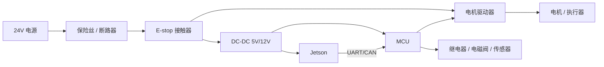

# 硬件与机构：电机、铰链、执行器、电子元器件

> 状态：设计稿。没有实现代码，也没有选定具体 BOM。  
> 范围：家庭/桌面级机器人；低压（≤48 V DC）；不涉及市电改造。  
> 原则：**软件零包管理器，不等于硬件零供应链。** 电机、驱动器、MCU、接插件都是买来的；能做的是选型、限幅、隔离、审计与测试。

---

## 1. 控制与供电拓扑

- **电机电源与逻辑电源分轨**；E-stop 只切电机动力，Jetson/MCU 保持供电以便记录与告警。
- 所有大电流回路走独立线径、独立接插件；信号线与电机线分开走线。
- 星形接地；CAN 双绞；长线加屏蔽与终端电阻。

---

## 2. 执行器选型

| 类型 | 优点 | 缺点 | 适用 |
|---|---|---|---|
| 有刷 DC + 编码器 | 简单、便宜、力矩大 | 电刷寿命、发热 | 轮子、简单关节 |
| 无刷 BLDC + FOC | 效率高、寿命长、可控力矩 | 驱动复杂、成本高 | 机械臂、云台、高动态 |
| 步进 | 定位简单、成本低 | 开环丢步、发热、噪音 | 低速定位、3D 打印机式机构 |
| 舵机 | 集成驱动、易用 | 背隙大、力矩有限、反馈少 | 轻负载、玩具级 |
| 电磁阀/推杆 | 直线动作、简单 | 只有两端、冲击 | 门锁、阀门、弹出机构 |

### 2.1 选型计算（必须做）

1. **负载力矩**：重力矩 + 摩擦力矩 + 加速力矩。
2. **安全系数**：≥2×（家庭场景有儿童/宠物，建议 2–3×）。
3. **转速**：关节最大角速度 → 电机转速 → 减速比。
4. **连续/峰值电流**：驱动器与电源按峰值留余量；连续电流决定发热。
5. **保持力矩**：重力负载必须能断电保持（抱闸/自锁/配重）。
6. **背隙**：减速箱背隙决定定位精度与抖动。

**不要**用“堵转电流”当工作电流；不要用“峰值力矩”当连续力矩。

---

## 3. 驱动器与功率

| 项 | 要求 |
|---|---|
| 电流限制 | 硬件可调/固定限流；软件再限一层 |
| 使能 | 独立 enable 脚，默认断开 |
| 故障回读 | 过流/过温/欠压/短路 |
| 制动 | 滑行/刹车可选；重力轴必须抱闸 |
| 隔离 | 大电流与逻辑隔离；光耦/数字隔离 |
| 续流 | 继电器/电磁阀必须续流二极管 |
| 保险 | 每个支路或至少总路；额定值可查 |
| 连接器 | 防反插、锁扣、应力释放 |

**判断**：安全的第一道防线是**驱动器硬件限流 + E-stop 切断动力**，不是 MCU 软件。

---

## 4. 关节与机构

### 4.1 旋转关节（铰链）

- 轴承支撑，避免电机轴承受径向力。
- 硬挡块 + 限位开关（常闭，fail-safe）。
- 减速比与编码器方向写入 `JointSpec`。
- 重力负载：抱闸/配重/自锁蜗轮；断电保持。
- 防夹：间隙、圆角、力矩限制、接触停止。
- 走线：过线孔/拖链，避免反复弯折。

### 4.2 直线机构

| 机构 | 关键点 |
|---|---|
| 丝杠 | 背隙、润滑、极限位置、过流即停 |
| 同步带 | 张紧、跳齿、限位 |
| 齿条 | 啮合间隙、异物 |
| 连杆 | 死点/奇异位形、行程校验 |
| 推杆 | 行程末端缓冲、过流保护 |

### 4.3 夹爪

- 力/电流双限；防夹检测（电流突变/接触传感器）。
- 指尖可更换；夹持面防滑。
- 断电行为明确：保持（自锁/弹簧）或释放（安全）。
- 不要用夹爪夹人；不要让人把手指伸入。

### 4.4 云台/头部

- 限位与线缆寿命；急停时停止。
- 摄像头隐私：物理遮挡/指示灯；不默认上传。

---

## 5. 电子与 IO

| 类别 | 规则 |
|---|---|
| GPIO | 只驱动逻辑/继电器模块；不直驱电机 |
| 继电器 | 续流、隔离、最大导通时间、默认断开 |
| 电磁阀 | 续流、浪涌、过流；断电气路安全 |
| ADC | 分压/滤波/钳位；不把 24V 直接进 MCU |
| I2C/SPI | 电平匹配、上拉、CRC；长线降速 |
| 限位开关 | 常闭；上拉；去抖；断线即“触发” |
| 编码器 | 差分/屏蔽；索引；方向校验 |
| 急停 | 常闭双通道（更高风险）；硬件接触器 |
| 电源监测 | 欠压/过压；brownout 复位 |

### 5.1 IO 安全默认

| IO | 上电/复位/失联默认 |
|---|---|
| 电机使能 | 断开 |
| 抱闸 | 闭合（保持） |
| 继电器 | 断开 |
| 电磁阀 | 断开/泄压 |
| 指示灯 | 可配置，但不表示“安全” |

---

## 6. BOM 参考（不绑定型号）

| 类别 | 参考 | 备注 |
|---|---|---|
| 边缘计算 | Jetson Orin Nano Super 8GB | 感知/技能/云连接 |
| MCU | STM32H7 / Teensy 4.1 / ESP32-S3 | 实时环；CAN/UART |
| 电机 | DC 减速电机 / BLDC / 步进 | 按力矩/转速选 |
| 编码器 | 增量/绝对 | 关节必备；轮子可选 |
| 驱动器 | 带限流/使能/故障回读 | 与电机匹配 |
| 限位 | 常闭机械开关/霍尔 | 每关节至少一个 |
| 急停 | 常闭按钮 + 接触器 | 切断电机动力 |
| 电源 | 24V/12V PSU + DC-DC | 电机/逻辑分轨 |
| 传感器 | IMU、ToF、超声、 bumper | 冗余 |
| 连接器 | 锁扣、防反插 | 大电流单独规格 |
| 保险 | 总路 + 支路 | 可更换 |

**采购原则**：有数据手册、有限流、有使能、有故障回读；不买“只有两根线”的裸电机驱动模块做安全相关动作。

---

## 7. 台架与首次上电

### 7.1 上电前

- [ ] 断电测量：电源极性、短路、保险。
- [ ] 驱动器使能默认断开。
- [ ] 电机线/编码器线无短路；相序正确。
- [ ] 限位开关常闭；断线测试。
- [ ] E-stop 切断动力；接触器动作正常。
- [ ] 机械硬挡块安装；人手远离运动范围。

### 7.2 首次上电（限流电源）

1. 限流电源设为额定电流的 20–30%。
2. 只使能一个关节；低速、小角度。
3. 校验编码器方向与限位。
4. 回零；记录 offset。
5. 阶跃响应；调 PID；观察跟随误差。
6. 堵转测试：电流限制生效，MCU 进 fault。
7. 热测试：连续运行 10 分钟，温度/电流。
8. E-stop/看门狗/断线测试。
9. 再装机构；先空载，再负载。

### 7.3 测试矩阵

| 测试 | 期望 |
|---|---|
| 限位断开 | 立即停止，不可自动恢复 |
| E-stop | 动力切断，<10 ms |
| 心跳丢失 | MCU 停止，<100 ms |
| 过流 | 驱动器限流 + MCU fault |
| 过温 | 降额/停止 |
| 编码器断线 | fault，不飞车 |
| 断电重启 | 默认未使能；需重新回零 |
| 通信 CRC 错误 | 丢弃 + 计数 + 超时停止 |

---

## 8. 安全与合规

- 参考：ISO 12100（风险评估）、ISO 10218-1/2、ISO/TS 15066、ISO 13482、IEC 60204-1、IEC 61508。
- DIY 设备通常**没有认证**；不要声称合规。
- 家庭场景：儿童/宠物/访客不可预测；默认低速、轻量、圆角、防夹。
- 市电部分必须用成品电源/合格人员；不要在市电上做实验。
- 责任：物理伤害、隐私、保险；高风险动作必须有人在场。

---

## 9. 零供应链的现实边界

| 层 | 能否“零供应链” | 说明 |
|---|---|---|
| 应用代码 | 是 | 只用 libc/OpenSSL/SQLite |
| MCU 固件 | 部分 | 裸机可自写；厂商 HAL/SDK 是依赖 |
| 电机/驱动器/芯片 | **否** | 必须采购；能做的是选型与审计 |
| 工具链 | 部分 | 编译器/CMake 是构建工具，不是运行时 |

**判断**：把“零包管理器”误当成“零 BOM”是不现实的。正确的目标是：**软件依赖最小、硬件有数据手册、固件可审计、每个执行器都有硬限幅**。

---

## 10. 与软件架构的接口

- `ActuatorSpec` / `JointSpec` / `MechanismSpec` / `IoSpec` 由边缘读取，写入技能注册表。
- 每个执行器有 `safe_state`；断联/复位/故障时进入该状态。
- 每个关节有软限位（边缘）+ 硬限位（MCU）+ 机械挡块（结构）。
- 每个技能有 `max_duration`、`max_velocity`、`max_force`；参数越界拒绝。
- 所有动作写入审计：谁、何时、什么参数、结果、是否人工批准。

---

## 11. 不做的事

- ❌ 用 GPIO 直接驱动电机。
- ❌ 市电上 breadboard。
- ❌ 没有保险丝/E-stop 就上电。
- ❌ 电机与逻辑共地且无隔离，导致复位/干扰。
- ❌ 用步进开环做安全相关动作而不装限位。
- ❌ 断电保持靠软件。
- ❌ 让模型直接写 PWM/电流/力矩。
- ❌ 在儿童可触及处保留夹点/锐边。
- ❌ 无人监督运行机械臂。
