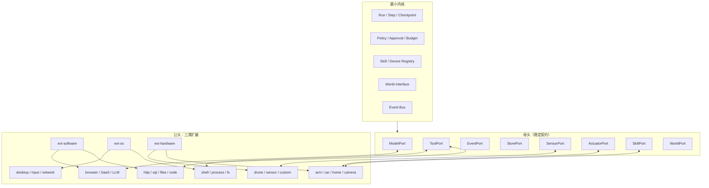
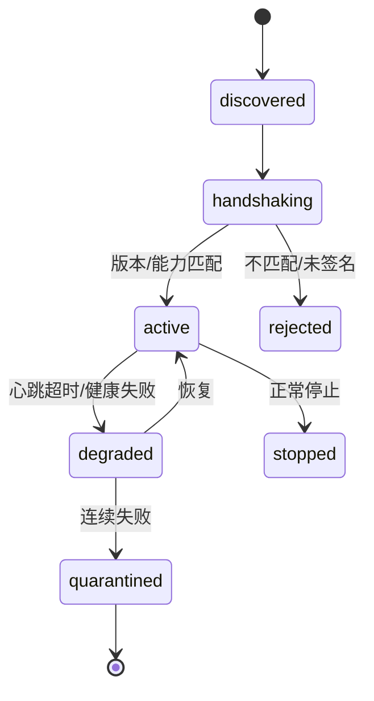

# Vortex：最小内核与“母头”

> 状态：设计稿。没有实现代码。  
> 定位：本系统只做**最小内核 + 稳定端口（母头）**；具体设备（机械臂、汽车、家电、想象不到的设备）在**独立项目**里实现适配器（公头）。  
> 原则：**端口窄而稳定，适配器宽而可丢弃。** 内核不认识“汽车”或“机械臂”，只认识能力、状态、技能与安全等级。  
> 本仓库只实现 kernel；所有 `ext-*` 在外部仓库，唯一例外是测试夹具 `ext-sim`。见 [scope.md](scope.md)。

---

## 1. 为什么是“母头”，不是插件市场

- 内核不能预知所有设备；把设备知识写进内核，必然腐化。
- 但“预留接口”很容易变成“预留一堆没人用的抽象”。
- 正确做法：**窄腰（narrow waist）**——少数稳定原语，大量外部实现。类似 POSIX/TCP：内核只定义 read/write/connect，具体驱动在外。

**判断**：先冻结 4 个端口（Model / Tool / Event / Store），有 2 个以上真实实现后再冻结 Sensor / Actuator / Skill / World。不要第一天设计 12 个端口。

---

## 2. 内核范围

| 属于内核 | 不属于内核 |
|---|---|
| Run/Step 生命周期、检查点、恢复 | 设备驱动、厂商 SDK |
| 策略、审批、预算、审计 | 汽车 CAN 信号、机械臂运动学 |
| 工具/技能注册表与路由 | 感知模型、SLAM、标定算法 |
| PWI：状态快照、事件、指代消解、接地 | 具体传感器融合实现 |
| 事件总线、扩展监督、健康检查 | UI、手机 App、语音前端 |
| 存储/工件引用、身份、配额 | 行业协议、云厂商适配 |
| 端口协议、版本协商、错误模型 | 第三方插件市场 |

目标：内核 **< 15k 行**（不含扩展、驱动、UI），可单二进制运行。

---

## 3. 端口目录（母头）



| 端口 | 方向 | 速率 | 用途 | 首版？ |
|---|---|---|---|---|
| `ModelPort` | 请求/流式 | 0.2–5 Hz | LLM 调用、工具调用、流式 | **是** |
| `ToolPort` | 请求/响应 | 按需 | 无状态工具（fs/http/sql） | **是** |
| `EventPort` | 发布/订阅 | 1–100 Hz | 状态变化、告警、审计 | **是** |
| `StorePort` | 请求/响应 | 按需 | 工件、快照、大输出 | **是** |
| `SensorPort` | 流 + 快照 | 10–200 Hz | 图像、IMU、编码器、力 | 第二阶段 |
| `ActuatorPort` | 命令 + 反馈 | 20–1000 Hz | 电机、铰链、夹爪、IO | 第二阶段 |
| `SkillPort` | 长任务 | 20–50 Hz | 带进度/取消的物理技能 | 第二阶段 |
| `WorldPort` | 查询 + 事件 | 1–50 Hz | 场景图、affordance、指代 | 第三阶段 |

**端口只传语义，不传设备细节**：`ActuatorPort` 传“关节目标/限幅/安全等级”，不传“CAN ID 0x123 的 bit 4”。

### 3.1 公头分类：software / os / hardware

扩展的第一层不是设备名，而是**权限与安全域**；设备名是叶子。

| 类 | 范围 | 典型端口 | 安全等级 | 沙箱 |
|---|---|---|---|---|
| `ext-software` | HTTP、SQL、文件、代码、浏览器、SaaS、LLM | ToolPort, ModelPort, EventPort | S0–S1 | 网络 allowlist；不挂宿主文件系统 |
| `ext-os` | shell、进程、文件系统、桌面、输入、网络 | ToolPort, SensorPort（屏幕）, ActuatorPort（输入） | S1–S2 | 独立用户/VM；显式审批；不碰设备总线 |
| `ext-hardware` | 机械臂、汽车、家电、相机、无人机、传感器 | SensorPort, ActuatorPort, SkillPort | S1–S3 | 独立进程；watchdog；HIL；E-stop |

**为什么这样分**：

- 三类的**权限模型**不同：软件只要网络；OS 要宿主控制；硬件要物理安全。
- 三类的**测试方式**不同：软件契约测试；OS 快照/恢复与逃逸测试；硬件 HIL/E-stop。
- 三类的**失效后果**不同：软件错是数据错；OS 错是整机失守；硬件错是人身伤害。

内核只需要知道 `class` 作为策略提示，不需要枚举具体设备。

---

## 4. 端口契约模板

每个端口必须定义：

```text
name, version
direction: request | stream | pubsub
schema: 消息类型、字段、单位、坐标系
lifecycle: open/ready/degraded/closed
timeouts, deadlines
idempotency: key 规则
cancel: 语义与最坏延迟
error model: code, retryable, evidence, safe_state
backpressure: 队列上限、丢弃策略
auth: 谁可以调用
safety_class: S0–S3
```

### 4.1 错误模型

```json
{"code":"OUT_OF_RANGE","retryable":false,"evidence":{"axis":"joint_3","value":2.1,"max":1.8},"safe_state":"hold"}
```

- 命令类错误必须带 `safe_state`。
- 遥测类错误只记录，不阻塞主循环。
- 不允许“静默成功”。

### 4.2 背压

| 数据 | 策略 |
|---|---|
| 遥测/图像 | latest-wins；旧帧丢弃 |
| 事件 | 有界队列；关键事件不丢 |
| 命令 | at-least-once + 幂等键；不允许丢 |
| 大工件 | 引用传递；不塞消息 |

---

## 5. 扩展清单（公头）

```yaml
id: ext-hardware.car
class: hardware          # software | os | hardware
version: 1.4.0
kernel: ">=1.2 <2.0"
implements: [SensorPort, ActuatorPort, SkillPort]
safety_class: S2
permissions: [can.read, can.write.limited, location.read]
resources: {cpu: 0.5, mem_mb: 128}
channels:
  control: unix:///run/agent/ext-car.sock
  telemetry: unix:///run/agent/ext-car.telemetry.sock
```

规则：

- `class` 决定默认沙箱、权限与审批策略；设备名放在 `id` 的叶子。
- `kernel` 是版本范围；不匹配拒绝加载。
- `implements` 声明端口；内核据此注册能力。
- `safety_class` 决定策略：S2 以上默认需要审批/限速。
- `permissions` 最小权限；没有声明就没有。
- `channels` 是进程间通道，不是动态库。

---

## 6. 进程边界，不是 ABI

**决定**：所有扩展是**独立进程**，通过 Unix domain socket + 帧协议通信；不加载 `.so`/`.dylib` 插件。

理由：

- 语言无关（C++/Rust/Go/Python 都能写扩展）。
- 崩溃隔离：扩展挂了，内核不受影响。
- 安全边界：独立 UID、seccomp、文件/网络权限。
- 版本隔离：ABI 不兼容不会炸内核。

### 6.1 帧协议

```text
magic "AGX1" | ver u8 | type u8 | flags u16 | len u32 | crc32 u32 | payload
```

- 控制通道：JSON（可读、易调试）。
- 高频遥测：二进制/定长结构（可选）。
- 心跳 1 Hz；超时 3 s 进入 degraded；连续 3 次失败隔离。
- 命令带 `id`、`deadline`、`idem_key`；取消带 `cancel(id)`。

### 6.2 生命周期



---

## 7. 信任与安全

| 风险 | 机制 |
|---|---|
| 恶意扩展 | 签名清单 + 允许列表；独立 UID；seccomp |
| 越权 | 能力令牌；默认拒绝；最小权限；按 `class` 分域 |
| 扩展直连执行器 | 不允许；必须经内核策略与安全监督 |
| `ext-os` 拿到宿主控制 | 独立用户/VM；只给声明路径；危险命令审批 |
| `ext-hardware` 绕过安全 | 独立 watchdog/E-stop；命令限幅；HIL 验证 |
| 扩展读私有数据 | 只给声明的数据通道；脱敏 |
| 供应链 | 扩展哈希固定；升级需审批；可回滚 |
| 崩溃/挂起 | 独立进程 + watchdog + 隔离 |
| 重放 | 命令带 nonce/时间戳；窗口 2 s |

**E-stop 不经过扩展**：硬件回路独立；扩展只能请求停止，不能阻止停止。

---

## 8. 版本与兼容

- 端口用 semver；内核支持当前大版本 + 上一个大版本。
- 扩展声明 `kernel: ">=1.2 <2.0"`；不匹配拒绝。
- 命令 schema **严格**：未知字段拒绝。
- 遥测 schema **宽松**：未知字段忽略，保证前向兼容。
- 弃用：至少 6 个月；文档标注替代端口。
- 端口冻结条件：**至少 2 个独立实现 + 6 个月生产使用**。

---

## 9. 参考扩展（都在内核之外）

```text
ext-software/
  ext-http, ext-sql, ext-files, ext-code, ext-browser
  ext-llm, ext-saas
ext-os/
  ext-shell, ext-process, ext-desktop, ext-input
  ext-network, ext-package
ext-hardware/
  ext-arm, ext-car, ext-home, ext-camera
  ext-drone, ext-sensor, ext-custom
```

| 类 | 扩展 | 实现端口 | 说明 |
|---|---|---|---|
| software | `ext-llm` | ModelPort | OpenAI/Anthropic/本地模型；密钥隔离 |
| software | `ext-http` / `ext-sql` / `ext-files` | ToolPort | 网络/数据库/文件；无设备 |
| software | `ext-browser` | ToolPort, SensorPort | 浏览器自动化；截图/下载 |
| os | `ext-shell` | ToolPort | 命令执行；白名单 + 沙箱 + 审批 |
| os | `ext-process` | ToolPort, SensorPort | 进程/资源；只读优先 |
| os | `ext-desktop` | ToolPort, SensorPort | 窗口/输入；隐私与误操作风险 |
| hardware | `ext-arm` | SkillPort, ActuatorPort | 关节/夹爪；限幅与回零 |
| hardware | `ext-car` | SensorPort, ActuatorPort | **先只读**（OBD/定位）；写操作限车窗/空调/充电，不碰转向/制动 |
| hardware | `ext-home` | ToolPort, ActuatorPort | 灯、锁、空调；不可逆操作审批 |
| hardware | `ext-camera` | SensorPort | 图像/事件；隐私脱敏 |
| — | `ext-sim` | 全部（参考） | 内核自带的仿真适配器，用于契约测试 |

**汽车的红线**：云端 agent 不得直接控制转向、制动、油门；只能做只读遥测、座舱舒适功能、充电计划，且必须有地理围栏/速度限制/驾驶员在场。汽车功能安全（ISO 26262）不是 DIY 能承担的。

---

## 10. 测试与一致性

- 每个端口一套 **conformance suite**：握手、schema、超时、取消、背压、崩溃恢复、错误码。
- `ext-sim` 是参考实现；内核 CI 必须跑通。
- 每个扩展项目自带契约测试；升级内核前先跑。
- 故障注入：kill、hang、错帧、重放、超限、乱序。
- 高频数据：验证 latest-wins 不阻塞控制通道。

---

## 11. 路线图（避免过度抽象）

| 版本 | 冻结端口 | 扩展类 | 说明 |
|---|---|---|---|
| v0.1 | Model, Tool, Event, Store | `ext-software` | 进程内适配器；先把单机跑通 |
| v0.2 | Sensor, Actuator | `ext-os`（受限） | 进程边界；shell/进程/桌面 |
| v0.3 | Skill, World | `ext-hardware` | 机器人台架、汽车只读 |
| v1.0 | 上述 8 个 | 三类 | 有 2+ 实现、6 个月使用后冻结 |

**不要**在 v0.1 就设计汽车/人形机器人专用端口；用能力描述与命名空间（`car.*`、`arm.*`）表达，而不是枚举设备。

---

## 12. 内核不该做的事

- ❌ 认识具体设备型号/协议。
- ❌ 加载动态库插件。
- ❌ 让扩展直接写数据库/文件系统。
- ❌ 让扩展绕过策略或 E-stop。
- ❌ 为“未来可能用到”预建大量空端口。
- ❌ 把 UI/语音/行业协议塞进内核。

**结论**：内核提供**窄而稳定的母头**：Run、Event、Tool/Skill、Sensor/Actuator、World、Store、Policy、Model。公头先分三类——`ext-software`、`ext-os`、`ext-hardware`——再往下分设备。三类对应不同的权限、沙箱、测试与失效后果；汽车、机械臂、以及现在想象不到的设备，都只是 `ext-hardware` 下的新叶子，不需要改内核。
