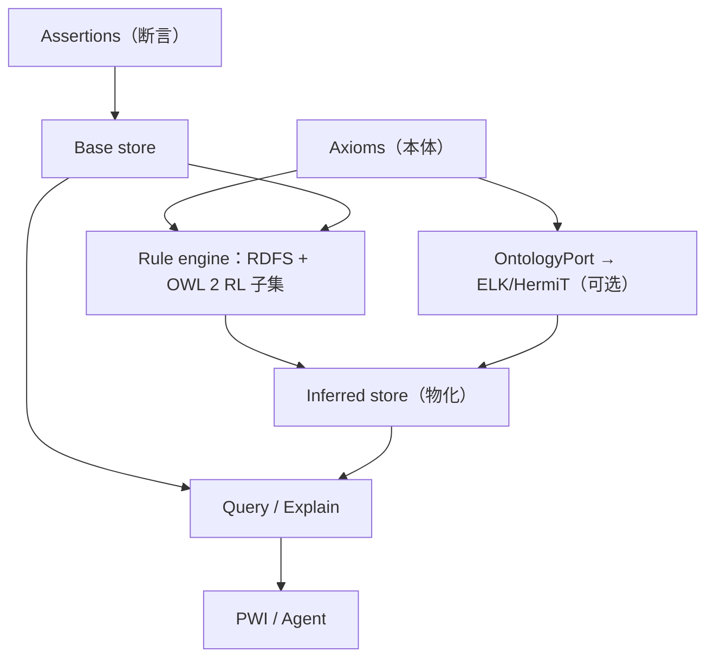

# Vortex Knowledge Layer：Kernel 内的开放世界知识

> 状态：设计稿。没有实现代码。  
> 范围：**知识层属于 kernel**；但“完整 OWL DL 推理器”不属于 kernel。  
> 目标：在 kernel 内提供 **OWL-compatible、open-world、可审计** 的知识底座；重推理通过可选 `OntologyPort` 外接。

---

## 1. 结论先行

可以，但要把“在 kernel 里实现 OWL”拆成三件事：

| 层 | 是否进 kernel | 说明 |
|---|---|---|
| **知识底座**：实体/关系、断言、状态、provenance、时间、冲突 | **是** | kernel 原语 |
| **轻量规则**：RDFS + OWL 2 RL 子集 + stratified Datalog | **是** | 可自写规则引擎，零依赖 |
| **约束**：SHACL-like shapes（写时/动作前校验） | **是** | 约束是执行契约，不是推理 |
| **视图**：property graph / temporal / tabular | **是** | 同一份断言的多种查询视图 |
| **完整 OWL EL/DL 推理**：ELK/HermiT/tableau | **否** | `OntologyPort` 独立进程 |
| **因果 / 概率 / 向量** | **否** | 领域扩展，按需接入 |

一句话：**kernel 拥有“开放世界知识的状态、规则、约束与视图”，不拥有“完整 OWL DL 推理器”。**

---

## 2. 为什么不能把 OWL DL 直接塞进 kernel

1. **复杂度**：OWL DL 需要 tableau/自动机推理；自写 C++ 实现是数月到数年，且很难正确。
2. **依赖**：成熟推理器（ELK/HermiT）是 Java 生态；与“零包管理器”冲突。
3. **性能与可预测性**：DL 推理可能不可判定/爆炸；kernel 需要硬预算与可恢复。
4. **语义错配**：OWL 是开放世界、无语义否定；文档里的 `false` 不是 OWL 原生概念，需要自定义层。
5. **领域知识**：本体是领域资产，不应硬编码进 kernel；kernel 只提供 schema 与规则接口。

**建议 profile**：

- 默认：RDFS + **OWL 2 RL 子集**（规则化、可前向链、可预算）。
- 可选：OWL 2 EL（外部 ELK）用于大规模分类；OWL 2 DL 只在离线/批处理。
- 不做：完整 OWL DL 在线推理。

---

### 2.1 KR 不是一种语言：用“最弱足够表达”的形式

知识表示不是“选一个本体语言”，而是**按保证与成本选形式**：

| 形式 | 保证 | 成本 | 典型用途 | 归属 |
|---|---|---|---|---|
| 类型化断言 + 状态 | 事实可追溯 | 低 | 实体、关系、unknown | kernel |
| RDFS / OWL 2 RL 子集 | 分类/属性蕴含 | 低 | 类层次、domain/range、inverse | kernel |
| Stratified Datalog | 递归推导 | 中 | 路径、依赖、规则链 | kernel |
| SHACL-like shapes | 结构/基数约束 | 低 | 写时校验、动作前检查 | kernel |
| Property graph | 遍历/邻域 | 低 | affordance、场景图 | kernel 视图 |
| Temporal assertions | 时间有效性 | 中 | 状态变化、事件时间 | kernel |
| OWL 2 EL/QL | 分类/查询重写 | 中高 | 大规模本体、查询展开 | `OntologyPort` |
| OWL 2 DL | 完整 DL 蕴含 | 高 | 离线/批处理 | 外部 |
| 因果图 / 概率 / 向量 | 干预/相似/不确定性 | 高 | 诊断、检索 | 领域扩展 |

**原则：最弱足够表达（weakest sufficient formalism）。**

- 能用断言+约束解决，就不要上规则；
- 能用 RL/Datalog 解决，就不要上 DL；
- 能用领域扩展解决，就不要进 kernel；
- 只有“没有它答不对”的案例足够多，才升级表示。

**判断**：KR 的价值不在“本体多大”，而在“表示是否匹配任务、是否可解释、是否可修订、是否能变成可执行约束”。

### 2.2 统一 IR，而不是统一语言

Kernel 只认一个**规范化中间表示（IR）**，再映射到不同形式：

```text
Term        : iri | blank | literal
Statement   : s, p, o, status, confidence, valid_time, provenance
Rule        : profile (rdfs|owl-rl|datalog), head, body, version
Constraint   : shape_id, target, cardinality, datatype, severity
View        : graph | table | temporal | vector
Revision    : supersedes, reason, actor, timestamp
```

- 断言是唯一事实来源；规则/约束/视图都是派生。
- 导入：Turtle/JSON-LD/OWL axioms/Datalog/SHACL shapes。
- 导出：同一份 IR 可导出为 OWL/Turtle/Datalog/SHACL，供外部工具使用。
- 不允许某个形式“拥有”状态；状态只在 IR 与 store 里。

## 3. 开放世界语义

### 3.1 四种状态

| 状态 | 含义 | 来源 |
|---|---|---|
| `true` | 被断言或蕴含 | 观察、工具、推断 |
| `false` | **显式否定**，或与 disjoint/cardinality 冲突 | 自定义否定断言、约束 |
| `unknown` | 既未断言也未否定 | 默认 |
| `conflicting` | 正负证据并存，或多个对象冲突 | 冲突检测 |

**关键**：OWL 本身没有“显式否定断言”。`false` 必须来自：

- 自定义 `negatedAssertion`（kernel 扩展）；或
- `disjointWith` / `complementOf` / `maxCardinality` 导致的矛盾；或
- 执行层的 closed-world 校验（只针对动作契约，不针对知识）。

### 3.2 不变量

1. **缺失 ≠ 假**：没有断言就是 `unknown`。
2. **不做 unique name assumption**：不同 IRI 不自动视为不同实体。
3. **不做自动 `sameAs`**：实体合并必须显式、有置信度、可撤销。
4. **断言与推断分离**：推断结果标记 `inferred=true` 与 `rule_id`，不覆盖断言。
5. **每个 unknown 有 provenance 与 resolution**；允许 `accepted_risk`（带 owner/到期）。
6. **知识开放，执行封闭**：动作参数仍走 JSON Schema/SHACL 式封闭契约。

---

## 4. 数据模型

```text
terms(id, iri, kind: class|property|individual, labels, version)
assertions(id, s, p, o, status, confidence, provenance_id,
           valid_from, valid_to, inferred, rule_id)
axioms(id, type, payload_json, version)   # subclass, domain, range, inverse, ...
provenance(id, source, method, trust, timestamp, raw_ref)
conflicts(id, a_id, b_id, reason, status, resolved_by)
entity_links(local_id, iri, confidence, method)
```

SQLite 表 + 索引：

- `assertions(s,p,o)`、`assertions(p,o)`、`assertions(s,p)` 覆盖常见模式。
- 图遍历用递归 CTE；深度/节点数硬上限，防查询爆炸。
- 断言不可变；修订写新行 + `supersedes`，保留历史。
- `valid_from/valid_to` 支持时间旅行；查询默认 `as_of=now`。

### 4.1 断言示例

```json
{
  "s": "sensor:cup_17",
  "p": "rdf:type",
  "o": "home:Cup",
  "status": "true",
  "confidence": 0.91,
  "provenance": {"source": "camera", "method": "detector_v3", "trust": 0.8},
  "valid_from": "2026-11-23T10:00:00Z"
}
```

未知：

```json
{
  "s": "sensor:cup_17",
  "p": "home:weight",
  "status": "unknown",
  "resolution": ["query:scale", "ask:user"],
  "provenance": {"source": "policy", "method": "schema_required"}
}
```

---

### 4.2 多视图，不是多份真相

| 视图 | 用途 | 实现 |
|---|---|---|
| Triple/IR | 事实与 provenance | SQLite 表 |
| Property graph | 邻域/路径/affordance | 由 IR 物化或递归 CTE |
| Temporal | as-of 查询、状态历史 | `valid_from/valid_to` + revision |
| Tabular | 报表/审计 | 视图/导出 |
| Vector（可选） | 相似实体/文本检索 | 扩展，不写回事实 |

**规则**：视图可从 IR 重建；不允许只改视图不改 IR。删除/修订必须回到 IR。

## 5. 规则与推理



### 5.1 Kernel 内置规则（首版）

| 规则 | 例子 |
|---|---|
| `rdfs:subClassOf` 传递 | `Cup ⊑ Container`，`Container ⊑ Object` |
| `rdfs:subPropertyOf` 传递 | `hasPart ⊑ hasComponent` |
| `rdfs:domain` / `range` | `weight` 的定义域/值域 |
| `owl:inverseOf` | `hasPart` / `partOf` |
| `owl:TransitiveProperty` | `partOf` 传递 |
| `owl:SymmetricProperty` | `siblingOf` |
| `owl:disjointWith` | 冲突检测 |
| `owl:equivalentClass`（受限） | 仅命名类等价，避免复杂表达式 |

**不做**：完整 EL 完成、tableau、复杂属性链、否定作为失败、自动 sameAs。

### 5.2 前向链

- 半朴素/增量物化；每轮记录 `rule_id` 与依赖。
- 硬预算：最大迭代、最大新增三元组、最大时间；超限停止并标记 `incomplete`。
- 变更时只重算受影响子图；支持全量重建作为兜底。
- 结果写 `inferred` 表；查询合并 base + inferred，但 `explain` 区分来源。

### 5.3 外部推理器

`OntologyPort`（可选、独立进程）：

- 输入：Turtle/OWL 导出 + 查询；
- 输出：蕴含三元组 + 证明/来源；
- 超时/内存/结果上限；
- 失败时降级到 kernel 规则，不影响主循环。

**判断**：ELK/HermiT 是可选加速器，不是 kernel 依赖。

---

## 6. 查询与解释

最小 API：

```text
Knowledge.assert(statement, provenance) -> id
Knowledge.retract(id, reason) -> revision_id
Knowledge.ask(s, p, o) -> true | false | unknown | conflicting
Knowledge.match(pattern, limit) -> [statement]
Knowledge.explain(statement_id) -> proof tree
Knowledge.subclasses(class, depth) -> [class]
Knowledge.neighbors(entity, predicate, depth) -> [entity]
Knowledge.snapshot(as_of) -> version
```

规则：

- 所有查询有 `limit`、`timeout`、`max_depth`。
- `explain` 返回断言链 + 规则 + provenance，不只返回布尔。
- 不接受任意 SPARQL 字符串；先做受限模式查询，避免注入与 DoS。
- 需要 SPARQL 时，走 `OntologyPort`，不进主循环。

---

## 7. 与 PWI / Agent 的关系

- 传感器/工具/用户输入 → `assertion`（带来源、时间、置信度）。
- PWI 的 `WorldSnapshot` 是知识层的一个**视图**，不是另一套状态。
- `unknown` 进入 policy：`ask / query / verify / act / defer / accept_risk`。
- affordance 用属性/类表达，查询时按 `subClassOf` 展开。
- 行动前仍走 closed-world 契约：参数 schema、单位、范围、安全包络。

---

## 8. Belief revision

| 场景 | 行为 |
|---|---|
| 新证据与旧断言冲突 | 新建断言；旧断言标 `superseded`；不删除历史 |
| 正负证据并存 | `conflicting`；按 trust/recency/specificity 排序；不静默选边 |
| 依赖被推翻 | 级联撤回 inferred 结果；记录 revision |
| 时间过期 | `stale` → 重新验证；不自动当假 |
| 实体合并 | 显式 `entity_link`；可撤销；不自动 `sameAs` |
| 来源可信度变化 | 重新评估冲突；保留原证据 |

**关键**：belief revision 是 kernel 原语；领域冲突解决策略可以配置，但“保留历史、可解释、可撤回”不能省。

---

## 9. 性能与规模

- 家庭规模：10^5–10^6 三元组足够；SQLite + 索引可支撑。
- 递归查询深度上限 8；返回上限 1k；超限报错而不是卡死。
- 物化表按 `rule_id`/`assertion_id` 索引；增量更新。
- 大本体/大批量推理走 `OntologyPort`，不在请求路径。
- 查询预算与 run 预算共享；知识查询也算成本。

---

## 10. 安全

| 风险 | 对策 |
|---|---|
| 不可信事实注入 | provenance/trust；外部内容低信任；不直接触发动作 |
| 查询 DoS | 深度/节点/时间上限；禁止任意 SPARQL |
| 规则爆炸 | 最大迭代/新增数；超限标记 incomplete |
| `sameAs` 污染 | 禁止自动合并；实体链接需审批 |
| 本体投毒 | 版本化、签名、评审；不允许运行时任意改 axioms |
| 推断被当事实 | `inferred` 标记；`explain` 必查；动作层不直接信推断 |

---

## 11. 测试

| 测试 | 内容 |
|---|---|
| 开放世界 | 缺失断言 → `unknown`，不是 `false` |
| 否定 | 显式否定 → `false`；正负并存 → `conflicting` |
| 子类/子属性 | 传递闭包正确；循环不死循环 |
| domain/range | 违规产生冲突/标记，不静默接受 |
| inverse/transitive | 对称/传递正确；边界有限 |
| 撤回 | 依赖级联撤回；历史保留 |
| 时间 | `as_of` 查询正确；过期标 stale |
| 解释 | 每个推断可追到断言+规则 |
| 预算 | 超限停止且标记 incomplete |
| 外部推理 | 超时/失败降级；结果带来源 |

---

## 12. 实施顺序

| 阶段 | 内容 | 人日 |
|---|---|---:|
| K0 | terms/assertions/provenance/状态/时间 schema | 8 |
| K1 | 查询/匹配/explain/冲突检测 | 8 |
| K2 | RDFS + OWL 2 RL 子集规则引擎 | 12 |
| K3 | belief revision / 级联撤回 / 快照 | 8 |
| K4 | Turtle/OWL 导入导出 + `OntologyPort` | 6 |
| K5 | 测试/预算/安全/文档 | 8 |

合计 **50 人日**（约 10 周，单人）。这会显著推迟 v0.1；建议放到 **v0.2/v0.3**，不要阻塞最小闭环。

---

## 13. 不做的事

- ❌ 在 kernel 内实现完整 OWL DL / tableau。
- ❌ 自动 `sameAs` / unique name assumption。
- ❌ 把缺失当假。
- ❌ 让推断覆盖断言。
- ❌ 接受任意 SPARQL 字符串。
- ❌ 把领域本体硬编码进 kernel。
- ❌ 把 OWL 当唯一表示；Datalog/SHACL/图视图按需使用。
- ❌ 追求“大一统本体”；从任务反推最小本体。
- ❌ 让知识查询无预算。

---

## 14. 结论

**可以，而且应该：kernel 需要开放世界知识底座。**  
但请把它定义为：

> **OWL-compatible knowledge substrate + RDFS/OWL 2 RL 子集规则引擎 + 可选外部 EL/DL 推理端口。**

这样 kernel 仍然零依赖、可审计、可预算；OWL 的完整推理能力在需要时通过 `OntologyPort` 接入，而不是把 kernel 变成推理器。**KR 的价值来自“表示匹配 + 可解释 + 可修订 + 可执行约束”，不是来自本体规模。**
