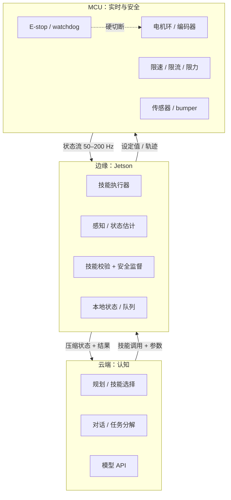
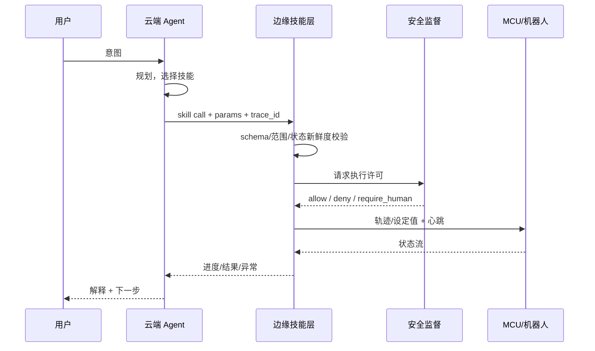
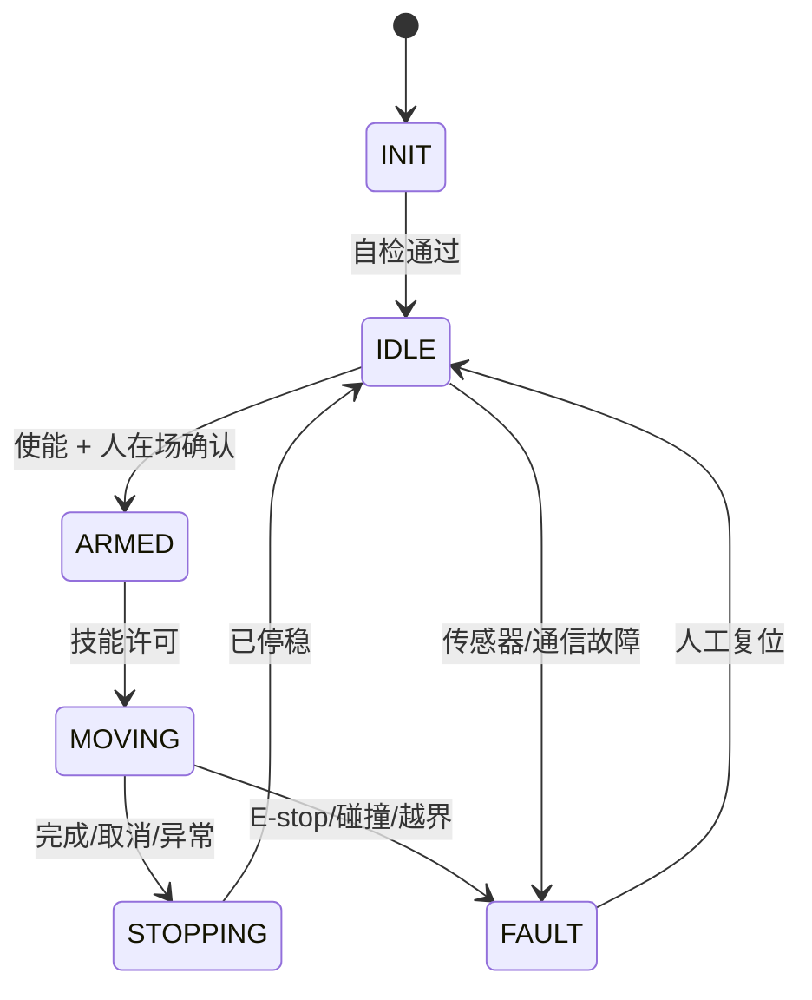

# 具身扩展：让通用 Agent 驱动机器人

> 状态：设计稿。没有实现代码。  
> 前提：模型在云端；边缘设备（如 Jetson Orin Nano Super 8GB）负责技能执行与安全；MCU 负责实时控制。  
> 一句话：**LLM 只调用技能，不输出关节力矩；安全回路独立于模型与网络。**

---

## 1. 核心原则

1. **三层控制**：云端认知（0.2–2 Hz）→ 边缘技能（20–50 Hz）→ MCU 实时（1–10 kHz）。
2. **技能而非力矩**：模型输出 `nav.move_to`、`arm.pick` 这类带参数的技能调用，永远不直接写 PWM/CAN 力矩。
3. **失效安全**：断网、超时、状态过期、越界、人靠近 → 停止/保持/返航，不是“继续执行最后一个计划”。
4. **安全独立**：E-stop、watchdog、限速/限力、地理围栏由硬件/MCU 执行，云端无权覆盖。
5. **能力可发现**：机器人通过 `RobotSpec` 暴露能力与限制；通用 agent 通过技能注册表发现并组合，不硬编码某一台机器人。

---

## 2. 三层架构



| 层 | 周期 | 职责 | 不负责 |
|---|---|---|---|
| 云端 | 0.5–5 s | 理解意图、选技能、编排、解释 | 实时控制、避障、平衡 |
| 边缘 | 20–50 ms | 感知、技能执行、校验、安全监督、断网兜底 | 电机电流环 |
| MCU | 0.1–1 ms | 电机控制、编码器、限幅、E-stop、watchdog | 任务规划 |

**判断**：把云端放进平衡/避障回路，等于把机器人交给网络抖动。云端只做“做什么”，边缘/MCU 做“怎么安全地做”。

### 2.1 控制栈：从目标到电机


| 层 | 例子 | 谁负责 | 关键约束 |
|---|---|---|---|
| 目标 | “把柜门打开” | 云端 | 自然语言/任务 |
| 技能 | `hinge.open` | 云端选，边缘执行 | 参数 schema、安全包络 |
| 运动原语 | `joint.move_to` | 边缘 | 关节范围、速度/加速度 |
| 轨迹 | 时间-位置点列 | 边缘 | 20–50 Hz 下发 |
| 关节 | 减速比、限位、回零 | 边缘/MCU | 软限位 + 硬挡块 |
| 执行器 | 电机 + 驱动器 | MCU | 电流/速度/位置环 |
| 机构 | 铰链、连杆、夹爪 | 机械设计 | 刚性、背隙、夹持力 |
| 反馈 | 编码器、电流、限位 | MCU | 新鲜度、故障检测 |

**关键**：技能与电机之间必须有一层“运动原语 + 关节”。没有这一层，模型的一个参数错误就会变成全速撞墙。

---

## 3. 技能契约（SkillSpec）

```text
name: nav.move_to
params: {x: float, y: float, theta: float, max_speed: float}
preconditions: [localized, battery > 20%, not e_stop]
postconditions: [distance_to(target) < 0.1]
max_duration_s: 60
abort: stop_and_hold
required_sensors: [lidar, imu, wheels]
safety: {max_speed: 0.5 m/s, geofence: home, human_distance: 1.0 m}
```

首版技能（只做少数、可验证）：

| 技能 | 说明 | 风险 |
|---|---|---|
| `nav.move_to` | 到点 | 中 |
| `nav.stop` | 立即停 | 低（永远可用） |
| `nav.return_to_dock` | 返航 | 中 |
| `head.look_at` | 看向目标 | 低 |
| `arm.pick` / `arm.place` | 抓/放 | 高 |
| `speak` | 说话 | 低 |

**规则**：

- 每个技能有参数 schema、前置条件、后置条件、最大时长、abort 行为。
- 参数必须做范围校验；未知字段拒绝。
- `nav.stop` 不受策略限制，任何角色、任何状态都可调用。
- 高风险技能（`arm.*`）默认需要人工确认或物理使能开关。

> 物理世界如何变成 LLM 能理解的状态、以及意图如何接地为动作，见 [world-interface.md](world-interface.md)。

### 3.1 设备模型：Actuator / Joint / Mechanism / IO

```text
ActuatorSpec:
  id, type: dc | bldc | stepper | servo | solenoid
  driver: {bus, address, current_limit_a, enable_pin}
  encoder: {type, cpr, index}
  gear_ratio, torque_constant, max_velocity, max_acceleration
  thermal: {max_temp_c, derate_at_c}
  safe_state: coast | brake | hold

JointSpec:
  id, actuator_id, type: revolute | prismatic
  axis, min, max, max_velocity, max_acceleration, max_torque
  homing: {method, switch_id, offset, direction}
  hard_stop: {min, max}
  gravity_load: bool          # 需要抱闸/配重

MechanismSpec:
  id, joints[], kinematics: simple | none
  end_effector, workspace, payload_kg
  pinch_points, compliance
  safe_state

IoSpec:
  id, kind: gpio | relay | solenoid | adc | i2c | spi
  safe_default, max_on_time_ms, isolation
```

**一个铰链** = `JointSpec`（旋转轴/限位/减速比）+ `ActuatorSpec`（电机/驱动/编码器）+ 硬挡块 + 回零开关。  
**一个夹爪** = `MechanismSpec`（行程/夹持力/指尖）+ 力/电流限制 + 防夹检测。  
**一个继电器/电磁阀** = `IoSpec`（安全默认断开、最大导通时间、续流/隔离）。

### 3.2 运动原语（只允许这些）

| 原语 | 参数 | 说明 |
|---|---|---|
| `joint.home` | joint_id, max_speed | 回零；失败即 fault |
| `joint.move_to` | joint_id, angle, max_vel, max_acc | 受软/硬限位约束 |
| `joint.move_velocity` | joint_id, vel, max_time | 必须有超时 |
| `joint.enable` / `disable` | joint_id | disable 进入安全状态 |
| `gripper.close` | mechanism_id, force_n, max_travel | 力/电流双限 |
| `mechanism.move_to` | mechanism_id, pose | 需要运动学 |
| `io.set` / `io.pulse` | io_id, state/ms | 继电器/电磁阀 |

**规则**：

- 所有运动必须有 `max_velocity`、`max_acceleration`、`max_duration`。
- 未回零/标定无效 → 拒绝运动。
- 软限位在边缘校验，硬挡块/限位开关在 MCU 执行。
- 禁止 `set_pwm`、`set_torque`、`set_current` 这类裸执行器接口暴露给模型。

---

## 4. 执行时序



**状态新鲜度**：边缘只接受 <200 ms 的机器人状态；过期则拒绝新技能，先进入 `STOPPING`。

### 4.1 控制回路

| 回路 | 频率 | 输入 | 输出 | 保护 |
|---|---:|---|---|---|
| 技能 | 0.5–5 Hz | 目标/技能 | 轨迹请求 | 预算/审批 |
| 轨迹 | 20–50 Hz | 轨迹请求 | 位置/速度设定 | 软限位/碰撞检查 |
| 关节 | 200–1000 Hz | 设定 + 编码器 | 速度/力矩指令 | 限速/限流/跟随误差 |
| 电流 | 1–10 kHz | 力矩指令 + 相电流 | PWM | 过流/过温/短路 |
| 安全 | 1–10 kHz | 限位/E-stop/心跳 | 使能/切断 | 硬件优先 |

**跟随误差**：指令与编码器差值超过阈值 → fault，不继续“加大电流追”。

---

## 5. 安全状态机



| 事件 | 行为 |
|---|---|
| 云端断网 >1 s | 中止当前技能 → `STOPPING`；不执行新计划 |
| 边缘→MCU 心跳丢失 >100 ms | MCU 本地停止 |
| E-stop 按下 | 硬件切断电机使能；软件记录 |
| 人进入安全距离 | 降速/停止；等待离开 |
| 状态过期 >200 ms | 拒绝新技能，先停 |
| 电池 <20% | 拒绝长距离技能；建议返航 |
| 越界（地理围栏） | 停止并回退到边界内 |

### 5.1 标定、回零与限位

1. **上电自检**：编码器在线、限位开关状态、驱动器故障位、温度。
2. **回零**：低速找零/限位，记录 offset；失败进入 `FAULT`。
3. **方向/减速比**：编码器计数方向与关节正方向一致；减速比写入 `JointSpec`。
4. **软限位**：由 `min/max` 与 offset 计算；每次运动前校验。
5. **硬限位**：机械挡块 + 限位开关；MCU 直接切断，不依赖边缘。
6. **背隙/弹性**：记录背隙；高精度场景做双向补偿。
7. **标定失效**：任何一项缺失/校验失败 → 拒绝运动，提示重新标定。

---

## 6. 延迟预算（设计目标）

| 环节 | 目标 | 说明 |
|---|---|---|
| 云端规划 | 0.5–5 s | 可接受，因为不进入实时回路 |
| 云端→边缘 RTT | 50–300 ms | 同城/家庭宽带 |
| 边缘技能循环 | 20–50 ms | 20–50 Hz |
| 边缘→MCU | <10 ms | 串口/CAN |
| MCU 电流环 | 0.1–1 ms | 1–10 kHz |
| E-stop 响应 | <10 ms | 硬件 |
| watchdog 停止 | <100 ms | MCU 本地 |

---

## 7. 失效模式

| 失效 | 后果 | 对策 |
|---|---|---|
| 模型幻觉出不存在技能 | 拒绝 | 技能注册表 + schema |
| 参数越界 | 拒绝 | 范围校验 + 安全包络 |
| 云端断网 | 机器人停 | 边缘本地兜底，不缓存新计划 |
| 状态过期 | 误判 | 新鲜度检查 + 停止 |
| 坐标/标定错误 | 撞 | 仿真 + 标定检查 + 低速试运行 |
| 传感器故障 | 撞 | 冗余/自检/降级 |
| 执行器失控 | 伤人 | 硬件限流 + E-stop + 物理围栏 |
| 重放/伪造命令 | 未授权动作 | mTLS + 签名 + 时间戳/nonce |

---

## 8. 安全包络

- **速度**：室内 ≤0.5 m/s；靠近人 ≤0.2 m/s；默认更低。
- **力/电流**：电机驱动硬件限流；软件再限一层。
- **地理围栏**：多边形 + 高度；越界即停。
- **人机距离**：超声/ToF/视觉；小于阈值降速，小于硬阈值停止。
- **物理**：E-stop、 bumper、保险丝、独立电机使能线。
- **监督**：首次运行、儿童/老人附近、新技能必须人工在场。

**不要**把安全寄托在模型判断上；模型可以“建议”，MCU 必须“强制”。

### 8.1 电子与 IO

| 项 | 规则 |
|---|---|
| GPIO | 只驱动逻辑/继电器模块，不直驱电机 |
| 继电器/电磁阀 | 续流二极管、隔离、最大导通时间、安全默认断开 |
| 电机驱动 | 硬件限流、使能脚、故障回读、制动/滑行可选 |
| 电源 | 电机与逻辑分轨；保险丝；防反接；欠压复位 |
| 地线 | 星形接地；大电流与信号分开；CAN 双绞 |
| 传感器 | 限位开关常闭（fail-safe）；IMU/ToF 自检 |
| 高压 | 市电部分必须由合格人员/成品电源处理，不上面包板 |

**安全默认**：任何 IO 在上电/复位/通信丢失时进入“断开/停止”状态。

### 8.2 机械与机构

| 机构 | 关键点 |
|---|---|
| 铰链 | 硬挡块、限位开关、阻尼、防夹；重力负载需抱闸/配重 |
| 连杆 | 死点/奇异位形；行程校验；避免自锁失效 |
| 丝杠/同步带 | 背隙、张紧、极限位置；过流即停 |
| 夹爪 | 力/电流双限；防夹；指尖可更换；断电保持或释放要明确 |
| 云台 | 限位、线缆寿命、急停 |
| 外壳 | 圆角、间隙、防夹；儿童可触及处尤其严格 |

**判断**：机械设计决定安全上限，软件只能在下限之上做约束。先把硬挡块、限位、抱闸做对，再谈“智能”。

---

## 9. 身份、命令与审计

- 每台机器人一个证书；边缘到云端 mTLS。
- 云端命令带 `trace_id + timestamp + nonce`；边缘拒绝超过 2 s 的旧命令，防重放。
- 命令只到“技能”层，不到执行器层。
- 审计：谁、何时、对哪台机器人、什么技能、什么参数、谁批准、结果。
- 高风险技能可要求第二人批准（双人规则）。

---

## 10. 硬件参考（Jetson + MCU）

> 电子、BOM、接线、台架步骤见 [hardware.md](hardware.md)。

| 部件 | 建议 | 说明 |
|---|---|---|
| 边缘计算 | Jetson Orin Nano Super 8GB | 感知、技能执行、云连接 |
| 实时控制 | STM32H7 / Teensy 4.1 / ESP32-S3 | 电机环、编码器、限幅、watchdog |
| 总线 | CAN 或 UART + CRC | 简单、可审计；不用 ROS 2 也能跑 |
| 电机驱动 | 带电流限制的驱动器 | 硬件限流优先 |
| 传感器 | IMU、编码器、ToF/超声、 bumper | 冗余 |
| 安全 | 硬件 E-stop、独立使能线、保险丝 | 不经过 Linux |
| 电源 | 电机与逻辑分轨；防反接/欠压 | 避免 brownout 复位 |
| 存储 | NVMe | 日志/模型/地图 |

Jetson 跑 Linux，不是硬实时；**实时环必须在 MCU**。Jetson 负责“慢思考”，MCU 负责“快反射”。

### 10.1 固件架构

- 裸机 C（或极小 RTOS），固定频率定时器；禁止动态分配。
- 模块：命令解析（CRC/序号）、关节控制（PID/FOC）、限位/E-stop、watchdog、故障记录、bootloader。
- 命令带 TTL；超时进入安全状态；复位后默认“未使能”。
- 固件签名 + 版本号；升级失败回滚；禁止未签名固件。
- 与边缘的协议：帧头 + 长度 + 类型 + 序号 + CRC；心跳 20 Hz。
- 关键：**MCU 不信任边缘**；所有限幅/限位/E-stop 在 MCU 再执行一遍。

---

## 11. 零供应链 vs ROS 2

| 方案 | 依赖 | 优点 | 缺点 |
|---|---|---|---|
| 自写 UART/CAN 协议 | 无 | 可控、可审计、小 | 生态少、驱动自己写 |
| ROS 2 | 大量包 + DDS | 生态、工具、仿真 | 与“零供应链”冲突；安全认证复杂 |
| 厂商 SDK | 厂商栈 | 上手快 | 锁定、审计难 |

**决定**：首版自写最小协议（帧头 + 长度 + CRC + 序号 + 心跳）；如果必须用 ROS 2，把它隔离在边缘，视为“厂商系统栈”，锁版本、限制包、独立网络。

---

## 12. 测试阶梯（不要跳级）

1. **纯仿真**：运动学 + 物理；录制/回放；技能参数 fuzz。
2. **HIL**：MCU + 电机在台架，轮子离地；验证限幅、watchdog、E-stop。
3. **围栏**：机器人在封闭区域；无人在场；低速；E-stop 可达。
4. **家庭试点**：一个房间、有人在场、地理围栏、低速度；记录 near-miss。
5. **扩展**：多房间、家庭成员、语音；只有指标达标才扩展。

| 指标 | 目标 |
|---|---|
| 技能成功率 | >95%（受控场景） |
| 非命令运动 | 0 |
| 围栏越界 | 0 |
| E-stop 测试 | 每日通过 |
| 断网安全停止 | 100% |
| 人工接管率 | 可观测，逐步下降 |

---

## 13. 标准与责任

- 参考：ISO 12100（风险评估）、ISO 10218-1/2（工业机器人安全）、ISO/TS 15066（协作）、ISO 13482（个人护理机器人）、IEC 60204-1（电气安全）、IEC 61508（功能安全）。
- **DIY 家庭机器人通常没有认证**；不要声称合规。
- 责任：物理伤害、隐私（摄像头/麦克风）、保险、儿童/老人监督。
- 不要在无人监督下让机械臂靠近人脸；不要做武器化改造。

---

## 14. 分阶段落地

| 阶段 | 目标 | 退出条件 |
|---|---|---|
| P0 | 技能 API + 仿真 | 10 个场景回放通过 |
| P1 | 台架机械臂/夹爪 | 限幅、E-stop、力控验证 |
| P2 | 围栏移动底盘 | 100 次导航无越界 |
| P3 | 家庭单房间 | 1 个月无 near-miss |
| P4 | 多房间/语音 | 家人可独立使用 |

---

## 15. 不做的事

- ❌ LLM 直接输出 PWM/CAN 力矩。
- ❌ 云端进入平衡/避障内环。
- ❌ 把网络当安全通路。
- ❌ 断网后继续执行缓存计划。
- ❌ 没有 E-stop 就上电。
- ❌ 在儿童/陌生人附近无监督运行机械臂。
- ❌ 为了“通用”而跳过仿真与围栏测试。

---

## 16. 与主架构的关系

机器人只是“工具层”的一个 provider；端口边界见 [kernel-ports.md](kernel-ports.md)：

- `ToolSpec` 扩展为 `SkillSpec`；`side_effect` 增加 `physical`。
- 策略引擎增加**物理安全包络**（速度/力/围栏/人距）。
- 状态增加**机器人状态流**（新鲜度、故障码）。
- 评估增加**仿真回放**与 **near-miss** 指标。
- 持久化不变：每个技能调用仍是一个 step，有幂等键与审计。

**结论**：通用 agent 可以让机器人动起来，但“通用”来自**技能注册表 + 安全包络**，不是让模型直接控制电机。云端负责“做什么”，Jetson 负责“怎么做”，MCU 负责“不许怎么做”。
