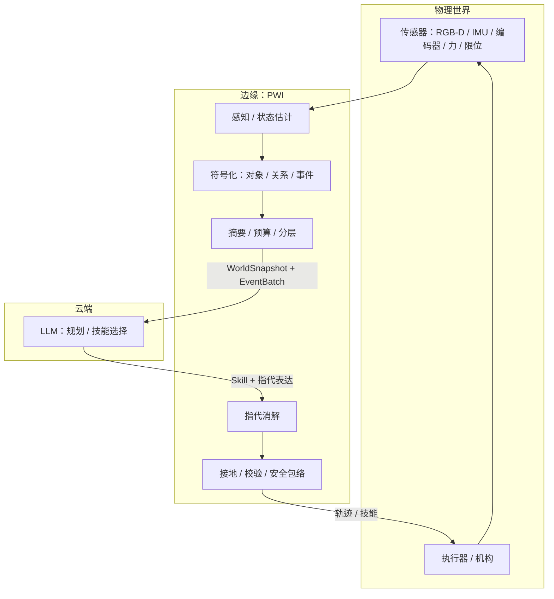
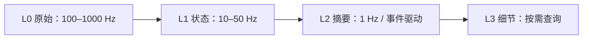
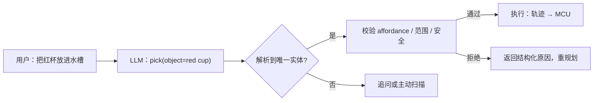

# 物理世界接口（PWI）：把传感器变成 LLM 能懂的“细腻”状态

> 状态：设计稿。没有实现代码。  
> 问题：模型不擅长实时控制、连续量、几何精度、传感器融合与不确定性；这些必须由 agent 层完成转换。  
> 一句话：**LLM 看到的不是原始传感器，而是一份带时间戳、单位、置信度、可追问的符号化世界状态；LLM 发出的不是力矩，而是带指代的技能意图，由 agent 层接地为可执行动作。**

---

## 1. 分工：模型做什么，agent 层做什么

| 能力 | LLM | Agent/PWI 层 |
|---|---|---|
| 目标理解、任务分解 | **强** | 提供可选项与约束 |
| 语言指代（“红杯子”） | **强** | 解析到唯一实体 ID |
| 常识与顺序 | **强** | 校验前置条件 |
| 实时控制（1–1000 Hz） | 弱 | **负责** |
| 传感器融合/坐标变换 | 弱 | **负责** |
| 力/接触/柔顺控制 | 弱 | **负责** |
| 不确定性建模 | 弱 | **负责** |
| 安全限幅/E-stop | 不应负责 | **负责** |
| 连续状态记忆 | 弱 | **负责**（状态存储 + 事件流） |
| 异常解释 | **强** | 提供结构化证据 |

**原则**：模型负责“做什么、为什么”，PWI 负责“现在是什么、能不能做、怎么做才安全”。

---

## 2. 双向管线



### 2.1 上行：物理 → LLM

1. **采集**：多传感器，带时间戳与时钟同步。
2. **感知**：检测/分割/位姿、SLAM、对象跟踪、接触/滑动检测。
3. **状态估计**：滤波/融合，输出带不确定性的状态。
4. **符号化**：场景图（对象、属性、关系）、affordance、事件。
5. **分层摘要**：按速率与 token 预算压缩；保留“可追问”的引用。
6. **交付**：`WorldSnapshot`（周期）+ `EventBatch`（变化）+ `query`（按需）。

### 2.2 下行：LLM → 物理

1. **意图**：`pick(object="red cup")`，不是坐标。
2. **指代消解**：映射到 `cup_17`；歧义则追问。
3. **接地校验**：affordance、前置条件、工作空间、安全包络。
4. **运动规划**：技能 → 轨迹（边缘，20–50 Hz）。
5. **执行**：MCU 1–10 kHz；限幅/E-stop 在 MCU。
6. **反馈**：进度、偏差、失败原因（结构化）。

---

## 3. 表示：分层、增量、可追问



| 层 | 内容 | 谁看 | 预算 |
|---|---|---|---|
| L0 | 原始帧、电流、编码器 | 边缘/MCU | 不进 LLM |
| L1 | 对象位姿、关节角、力、限位 | 边缘 | 本地 |
| L2 | 场景摘要、事件、affordance | LLM | 1–3k tokens/次 |
| L3 | 单对象细节、历史轨迹、图像 | LLM 按需 | 按查询 |

### 3.1 快照示例（结构化）

```json
{
  "as_of": "2026-11-20T16:30:12.120Z",
  "frame": "world",
  "robot": {"pose": [1.2, 0.4, 0.0], "battery": 0.62, "mode": "idle"},
  "objects": [
    {"id": "cup_17", "label": "cup", "color": "red", "pose": [1.8, 0.9, 0.75],
     "graspable": true, "confidence": 0.91},
    {"id": "sink_2", "label": "sink", "pose": [2.4, 1.1, 0.8],
     "affordances": ["place_inside"]}
  ],
  "relations": [
    {"subject": "cup_17", "predicate": "on", "object": "table_3"}
  ],
  "events": [
    {"type": "human_entered", "zone": "kitchen", "distance_m": 1.4, "t": "...120Z"}
  ],
  "unknowns": ["cup_17.weight", "cup_17.temperature"]
}
```

### 3.2 同一状态的自然语言摘要（给 LLM 的“细腻”版本）

> 截至 16:30:12.120Z：红杯 `cup_17` 在 `table_3` 上，距机器人 0.6 m，可抓，置信度 0.91；水槽 `sink_2` 在右前方 0.8 m，可放入；有人进入厨房，距 1.4 m。杯子重量与温度未知。

**原则**：

- **稳定 ID**：`cup_17` 跨帧不变；LLM 不得发明 ID。
- **单位与坐标系**：所有数值带 SI 单位与 `frame`。
- **置信度与新鲜度**：每个关键对象带 `confidence` 与 `as_of`。
- **未知显式化**：`unknowns` 比编造更有用。
- **增量优先**：只发变化事件；全量快照降频。
- **可追问**：摘要里保留引用，LLM 可 `query("cup_17.weight")`。

---

## 4. 事件：比轮询更适合 LLM

| 事件 | 负载 | 用途 |
|---|---|---|
| `object_appeared` / `disappeared` | id, label, pose, confidence | 触发关注 |
| `object_moved` | id, from, to, delta | 更新计划 |
| `grasp_succeeded` / `failed` | id, force, slip | 决定重试 |
| `door_blocked` | force, current, angle | 判断卡住 |
| `human_entered` / `left` | zone, distance | 降速/停止 |
| `joint_fault` / `over_temp` | joint, code | 安全停机 |
| `battery_low` | percent, estimated_range | 返航 |

事件必须带：`t`、`entities`、`measurements`、`confidence`、`severity`、`suggested_actions`（可选）。  
**关键事件不压缩**；低价值事件聚合（如“物体轻微移动 3 次”）。

---

## 5. 指代消解与接地



### 5.1 解析规则

- 优先用**已观测实体**；不把语言模型生成的坐标当真。
- 多个候选 → 返回 `Ambiguous(candidates=[...])`，让 LLM 追问或选择。
- 实体丢失 → `NotFound`，建议扫描/等待；不要猜。
- 指代（“它”“那个”）→ 用对话上下文 + 最近注视对象；仍歧义则追问。

### 5.2 接地校验

| 检查 | 失败行为 |
|---|---|
| 对象存在且新鲜（<200 ms） | 拒绝，刷新 |
| affordance 支持该技能 | 拒绝，给出可用技能 |
| 参数在范围/单位正确 | 拒绝，指出字段 |
| 工作空间/可达性 | 拒绝，建议移动底座 |
| 人距/围栏/速度/力 | 拒绝或降速 |
| 技能前置条件 | 拒绝，列出缺失 |

**返回结构化原因**，例如 `denied: {code: "OUT_OF_REACH", object: "cup_17", distance_m: 0.92, max_reach_m: 0.75}`。LLM 据此重规划，而不是盲目重试。

---

## 6. 不确定性：不要把“猜”说成“是”

- 每个对象/测量带 `confidence`（0–1）与来源（传感器/模型/先验）。
- 范围比点估计更有用：`distance_m: [1.3, 1.5]`。
- 低于阈值 → 标记 `uncertain`，触发主动感知（转一下、靠近、再拍一张）。
- 不让 LLM 做概率乘法；PWI 给出“是否足够可靠”的结论。
- 传感器冲突 → 保留两个假设，要求澄清/探查，不强行融合。

---

## 7. 时间与新鲜度

| 数据 | 允许年龄 | 过期行为 |
|---|---|---|
| 机器人位姿 | 100 ms | 停止/拒绝新技能 |
| 障碍物/人距 | 200 ms | 降速/停止 |
| 对象位姿 | 500 ms | 标记不确定，重新观测 |
| 地图/语义 | 分钟级 | 可用，但标注 |
| 电池/温度 | 1 s | 可用 |

**所有快照带 `as_of`**；LLM 的规划必须基于“截至某时刻”的状态。过期状态不能用于运动。

---

## 8. Token 与带宽预算

| 内容 | 目标 |
|---|---|
| 周期快照 | 1–3k tokens |
| 事件批 | 100–300 tokens |
| 单对象细节查询 | 100–500 tokens |
| 图像 | 仅在必要时发送；优先结构化描述 |
| 原始传感器 | 永不出边缘 |

策略：变化驱动 + 分层摘要 + 按需查询；不要每轮把整个场景重发。

---

## 9. 失败模式与对策

| 失败 | 后果 | 对策 |
|---|---|---|
| 状态过期 | 撞/抓空 | 新鲜度检查；过期即停 |
| 对象 ID 跳变 | 抓错 | 稳定 ID + 重识别 + 置信度 |
| 单位/坐标系错误 | 撞 | schema 强制单位与 frame |
| 摘要漏掉关键细节 | 误判 | 关键事件不压缩；可追问 |
| LLM 编造坐标/ID | 危险 | 只接受注册表 ID；坐标必须来自状态 |
| 置信度被忽略 | 冒进 | 策略层按置信度降级/追问 |
| 传感器冲突 | 错误融合 | 保留假设；主动感知 |
| 事件风暴 | 上下文爆炸 | 聚合/去重/限速 |

---

## 10. 接口（设计契约）

```text
WorldModel.snapshot(budget_tokens, since) -> WorldSnapshot
WorldModel.query(path) -> Value | Unknown
WorldModel.events(since, max) -> EventBatch

Resolver.resolve(reference, context) -> Entity | Ambiguous | NotFound
Grounder.check(skill, params, state) -> Allow | Deny(code, evidence) | Ask(question)
SkillExecutor.execute(skill, params) -> Progress | Result | Failure(code, evidence)
```

**不变量**：

- LLM 永远拿不到裸执行器接口。
- 所有 ID 来自注册表；所有坐标来自状态或标定。
- 所有拒绝都带结构化原因与证据。
- 所有状态都可追溯到时间、来源、置信度。

---

## 11. 测试

| 测试 | 方法 |
|---|---|
| 状态摘要正确性 | 录制传感器日志回放，断言关键字段 |
| 指代消解 | 歧义/缺失/对抗性表达 |
| 事件检测 | 精确率/召回率/延迟 |
| 过期处理 | 注入延迟，验证拒绝/停止 |
| 接地校验 | 越界/不可达/错误单位 |
| Token 预算 | 统计每轮 token，超限降级 |
| 端到端 | 仿真 + HIL + 围栏 |

---

## 12. 与主架构的关系

- PWI 是**工具层与状态层之间的适配器**，不是新框架。
- 上行输出进入 `RunState` 的观察字段；下行输入走 `SkillSpec` 与策略引擎。
- 所有物理事件写入 `events` 表，参与审计与回放。
- 机器人状态是“外部状态”，不塞进模型权重或隐式记忆。

**结论**：模型不需要“看见原始世界”，它需要一份**可理解、可追问、带不确定性的世界摘要**；agent 层负责把物理世界的连续性、噪声与实时性挡在模型之外，把可决策的符号与证据递进去。
